# Twintania

Twintania 的機制一開始是基本循環，並會隨戰鬥進行逐漸變得複雜。此階段可依 Twintania 的 HP 分為三個子階段。

---

## 第一階段：100% HP - 75% HP

Twintania 的第一階段是對接下來機制的基本介紹，包括 Twisters 和 Fireball 分攤。將 Twintania 的 HP 壓至 75% 以下後，階段便會結束。

<table>
  <tr>
    <td width="50%">
      
<b>1.</b> 將 Twintania 拉至西北方標記，並讓牠背對隊伍，以免 Plummet 擊中其他人。

      
其餘隊員分散站位，但請確保除坦克外的所有人都能順利移動至 Twintania 背後。

    </td>
    <td>
      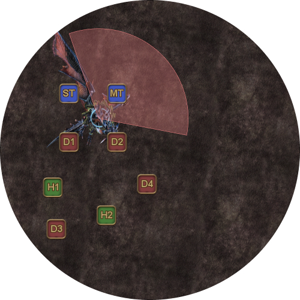
    </td>
  </tr>
  <tr>
    <td>
      
<b>2.</b> Twintania 會隨機標記一名非坦克玩家作為 Fireball 目標，並施放 Twister。

所有玩家都在原地引導 Twisters。

      
同時，除坦克與 D3 外，其他玩家移動到 Twintania 背後集合，以 5 人分攤 Fireball 傷害。

      <ul>
        <li><b>D3: </b> 除非你是 Fireball 目標，否則不要加入 Fireball 分攤。</li>
        <li><b>D4: </b>除非 D3 是 Fireball 目標，否則加入 Fireball 分攤。</li>
      </ul>
      
必須透過減傷才能承受這次 Fireball——使用護盾、<em>Sacred Soil/Kerachole</em> 以及 <em>Troubadour/Tactician/Shield Samba</em> 等技能。

      
<b>不要</b>使用 <em>Reprisal、Feint 或 Addle</em> 等降低敵方傷害的減益效果。

    </td>
    <td>
      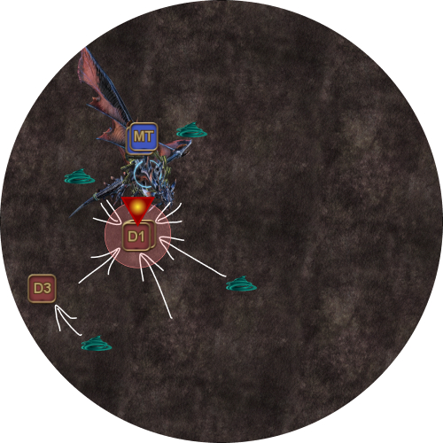
    </td>
  </tr>
  <tr>
    <td>
      
<b>3.</b> 接著 Twintania 會施放 Death Sentence，這是單體坦克死刑，並會附加斬擊耐性降低效果，因此必須換坦。之後循環會從 Plummet 重複（MT 與 ST 互換）。

      
<em>（大多數隊伍會在第二次 Fireball 出現前，便將 Twintania 壓入下一階段。）</em>

    </td>
    <td>
      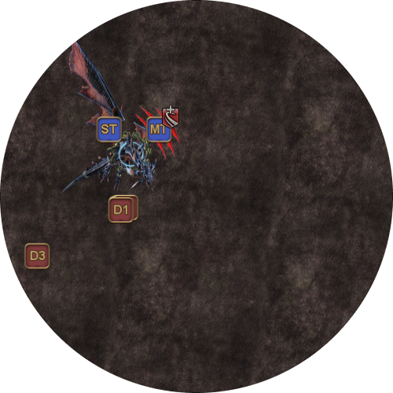
    </td>
  </tr>
</table>

---

## 第二階段：74% HP - 45% HP

第二階段延續第一階段的機制，並加入 *Liquid Hell* 和 *Hatches*。

將 Twintania 的 HP 壓至 45% 以下後，階段便會結束。

<table>
  <tr>
    <td width="50%">
      
<b>4.</b> 順時針將 Twintania 拉至下一個標記。

    </td>
    <td>
      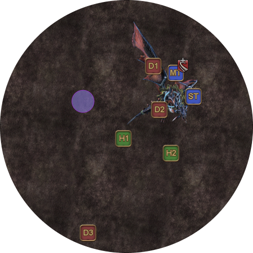
    </td>
  </tr>
  <tr>
    <td>
      
<b>5.</b> 接著 Twintania 會施放五輪 <em>Liquid Hell</em>，由距離 Twintania 超過 15 yalms 的隨機玩家引導（若無人超過 15 yalms，則會隨機選擇一名玩家）。

      <ul>
        <li><b>D3:</b> 引導 <em>Liquid Hells</em>。</li>
        <li><b>其他所有玩家：</b>待在 Twintania 附近，以免意外成為 <em>Liquid Hell</em> 目標。</li>
      </ul>
    </td>
    <td>
      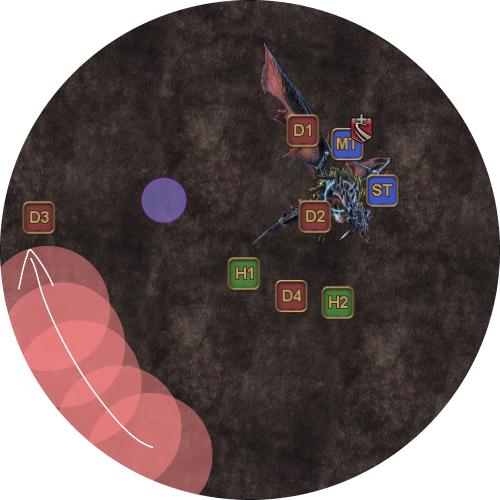
    </td>
  </tr>
  <tr>
    <td>
      
<b>6.</b> Twintania 施放 <em>Generate</em>，標記一名隨機輸出職。

      
黑色光球會在 Twintania 腳下出現，並朝被標記的玩家移動。

      
所有玩家都應避開 Twintania 與 Neurolink 之間的區域，以免被黑色光球擊中。

    </td>
    <td>
      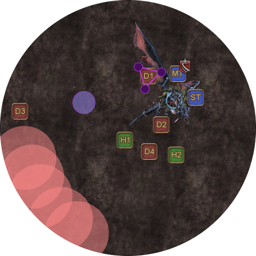
    </td>
  </tr>
  <tr>
    <td>
      
<b>7. </b>被標記的玩家必須在 Twintania 先前留下的 Neurolink 內承受黑色光球，否則全隊會團滅。

      
光球還會在周圍爆炸造成 AoE 傷害，請確保其他玩家不會被擊中。

      
光球也會附加 <em>Mana Hypersensitivity</em> 減益，持有者不能再被第二顆光球擊中。此時不會造成影響，但稍後會派上用場。

      
此時 Twintania 會開始另一輪五次引導型 <em>Liquid Hells</em>。

      <ul>
        <li><b>D3:</b> 引導 <em>Liquid Hells</em>。</li>
        <li><b>H2 或 D4：</b>若 D3 被 <em>Hatch</em> 點名，改由你接手引導這一輪 <em>Liquid Hell</em>。</li>
      </ul>
    </td>
    <td>
      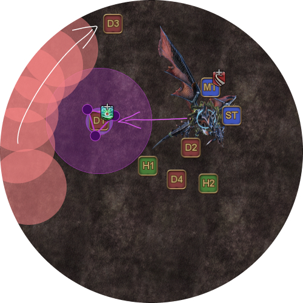
    </td>
  </tr>
  <tr>
    <td>
      
<b>8. </b>接著 Twintania 會對目前的目標再次施放 <em>Death Sentence</em>。

      <ul>
        <li><b>MT、ST：</b>換坦。</li>
      </ul>
    </td>
    <td>
      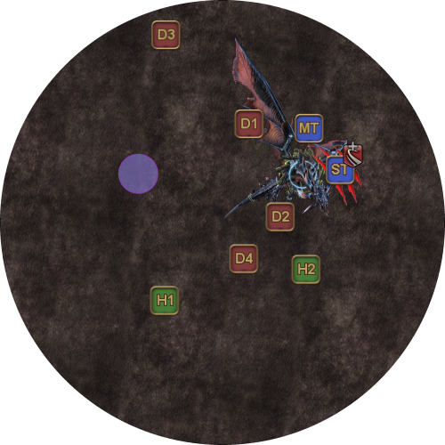
    </td>
  </tr>
  <tr>
    <td>
      
<b>9. </b>Twintania 隨機以一名輸出職為 <em>Hatch</em> 目標。

      
這次，該輸出職必須預先站在 Neurolink<b>外側</b>。

    </td>
    <td>
      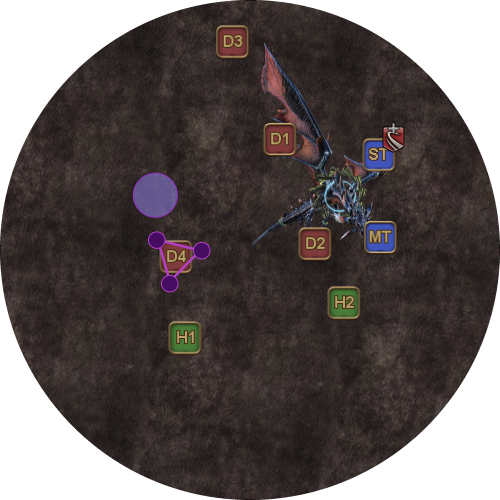
    </td>
  </tr>
  <tr>
    <td>
      
<b>10. </b>接著 Twintania 會施放 <em>Twister</em>。

      
所有玩家移動躲避 <em>Twister</em>。被 <em>Hatch</em> 點名的輸出職先在 Neurolink 外引導 Twister，再進入 Neurolink 處理 <em>Hatch</em>。

      
<em>(若隊伍輸出較高，可能會跳過這輪 <em>Twisters</em>。持有 <em>Hatch</em> 的輸出職應留意 Twintania 的 HP，確認是否跳過了 <em>Twisters</em>。)</em>

    </td>
    <td>
      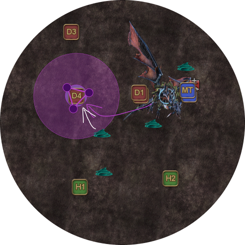
    </td>
  </tr>
  <tr>
    <td>
      
<b>11. </b>接著 Twintania 會施放 <em>Plummets</em>，然後從第一輪引導型 <em>Liquid Hells</em> 開始重複循環。
</td>
    <td>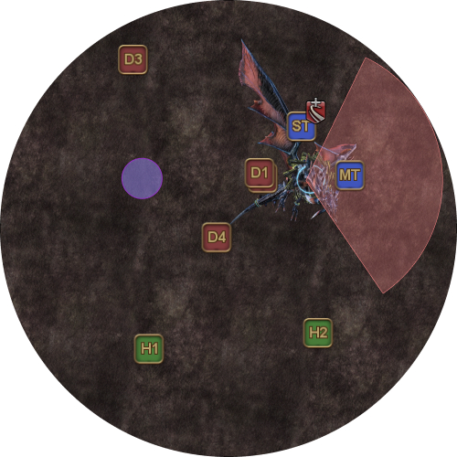</td>
  </tr>
</table>

---

## 第三階段：44% HP - 0% HP

此階段集合了目前為止登場的所有機制。

<table>
  <tr>
    <td width="50%">
      
<b>11. </b>順時針將 Twintania 拉至下一個標記。

    </td>
    <td>
      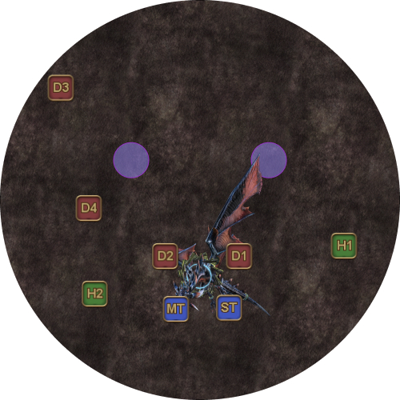
    </td>
  </tr>
  <tr>
    <td>
      
<b>12. </b>Twintania 會施放五輪引導型 <em>Liquid Hell</em>。

      <ul>
        <li><b>D3:</b> 引導 <em>Liquid Hells</em>。</li>
        <li><b>其他所有玩家：</b>待在 Twintania 附近，以免意外成為 <em>Liquid Hell</em> 目標。</li>
      </ul>
    </td>
    <td>
      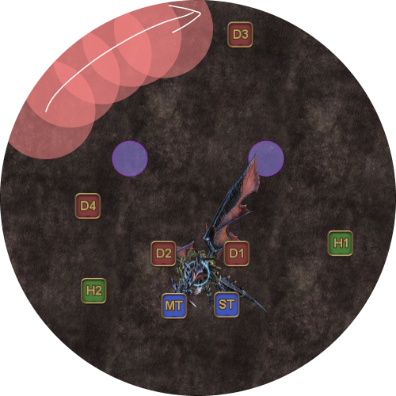
    </td>
  </tr>
  <tr>
    <td>
      
<b>13. </b>Twintania 施放 <em>Generate</em>，這次會標記兩名隨機輸出職，並生成兩顆朝被標記玩家移動的黑色光球。

      
所有玩家都應待在 Twintania 與兩個 Neurolink 所形成的三角形之外，以免撞上黑色光球。

    </td>
    <td>
      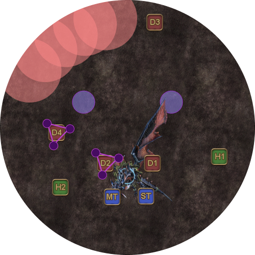
    </td>
  </tr>
  <tr>
    <td>
      
<b>14. </b> 由於被黑色光球擊中會附加 <em>Mana Hypersensitivity</em> 減益，兩名被點名的輸出職必須分別進入不同的 Neurolink。

    </td>
    <td>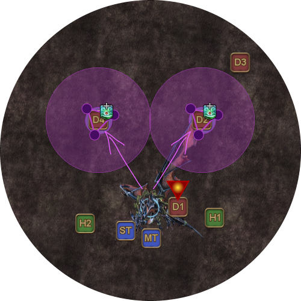</td>
  </tr>
  <tr>
    <td>
      
<b>15. </b>Twintania 隨機標記一名玩家分攤 <em>Fireball</em>，同時準備另一輪五次 <em>Liquid Hells</em>。

      
這輪 <em>Liquid Hells</em><b>不會</b>由玩家引導，而是會隨機指定一名玩家（目前持有仇恨的坦克除外）。

      
在 Twintania 背後處理 Fireball 分攤；被 <em>Liquid Hell</em> 點名的玩家要避免把火圈放在集合點。

      
請注意，<em>Hatch</em>、<em>Fireball</em> 和 <em>Liquid Hell</em> 的目標<b>彼此獨立</b>，同一名玩家可能同時被<em>三種機制</em>點名。

      
遇到這種情況時，請<b>先處理 Hatch。</b>由於 <em>Liquid Hell</em> 目標每次都會受到傷害，應避免加入 <em>Fireball</em> 分攤（除非同時也是 <em>Fireball</em> 目標）。

    </td>
    <td>
      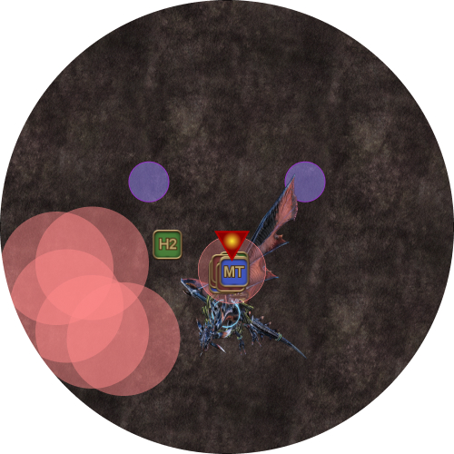
    </td>
  </tr>
  <tr>
    <td>
      
<b>16. </b>接著 Twintania 會準備對持有仇恨的坦克施放 <em>Death Sentence</em>。

      <ul>
        <li><b>MT、ST：</b>換坦。</li>
      </ul>
    </td>
    <td>
      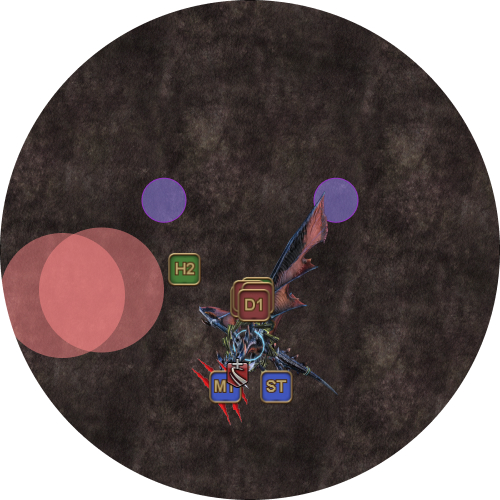
    </td>
  </tr>
  <tr>
    <td>
      
<b>17. </b>接著 Twintania 會對新坦克施放 <em>Plummets</em>。舊坦克應迅速離開攻擊路徑，避免承受不必要的傷害。

    </td>
    <td>
      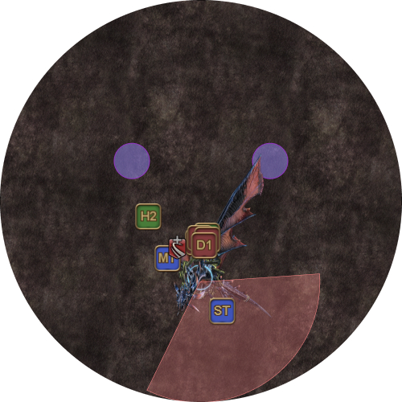
    </td>
  </tr>
  <tr>
    <td>
      
<b>18. </b>Twintania 施放 <em>Generate</em>，隨機以兩名輸出職為 <em>Hatch</em> 目標。

      
與上一階段相同，被點名的玩家應待在 Neurolink 旁，不要進入。

    </td>
    <td>
      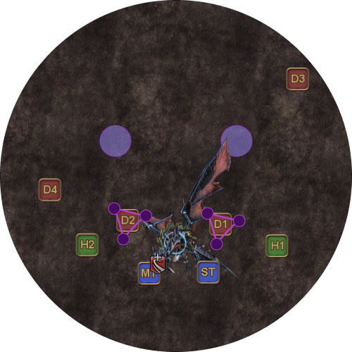
    </td>
  </tr>
  <tr>
    <td>
      
<b>19. </b>Twintania 會施放 <em>Twister</em>。

      
所有玩家移動躲避 <em>Twister</em>；兩名持有 <em>Hatch</em> 的輸出職先在外側引導 <em>Twisters</em>，再進入 Neurolinks 處理 <em>Hatch</em>。

    </td>
    <td>
      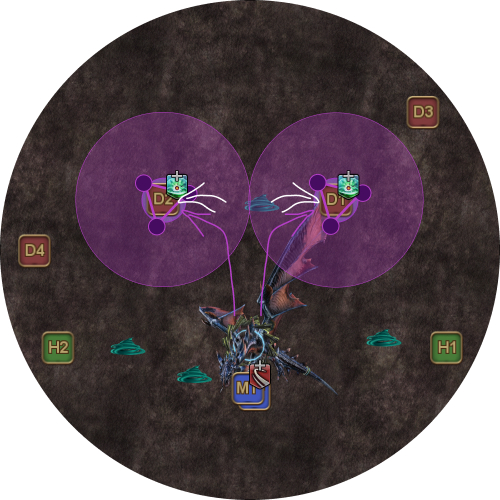
    </td>
  </tr>
  <tr>
    <td>
      
<b>20. </b>接著 Twintania 會對目前的坦克施放 <em>Plummets</em>，然後從引導型 <em>Liquid Hells</em> 開始重複此階段。

      
<em>(現在隊伍通常會在下一輪 Hatches 左右擊殺 Twintania。)</em>

    </td>
    <td>
      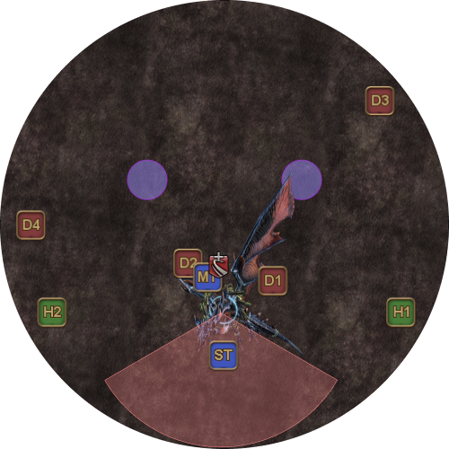
    </td>
  </tr>
</table>

---

## Heavensfall（轉場至 Nael）

<table>
  <tr>
    <td width="50%">
      
<b>21. </b>Twintania 消失前會留下第三個、也是最後一個 Neurolink。

      
隊伍應在南側地標集合。坦克也可以選擇改站北側。
</td>
    <td>
      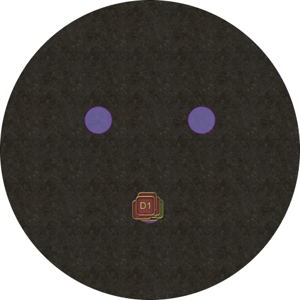
    </td>
  </tr>
  <tr>
    <td>
      
<b>22. </b>Heavensfall 塔落在場地中央，對所有玩家造成距離衰減傷害，並將玩家擊退至場地邊緣。

    </td>
    <td>
      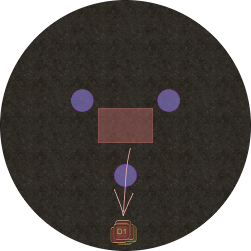
    </td>
  </tr>
  <tr>
    <td>
      
<b>23. </b>玩家應如圖所示展開，在 Heavensfall 塔的扇形 AoE 之間分散站位。

      
四名隨機玩家會各自受到 <em>Meteor Stream</em> AoE 攻擊，範圍不可重疊。

    </td>
    <td>
      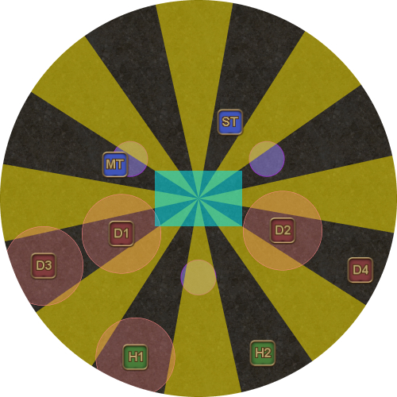
    </td>
  </tr>
  <tr>
    <td>
      
<b>24. </b>第二輪扇形 AoE（攻擊先前安全的區域）會與第二輪 Meteor Streams 同時出現，攻擊其餘四名玩家。

      
玩家應視情況順時針或逆時針移動，離開南側位置，避免第二輪時又躲進相同扇區。

    </td>
    <td>
      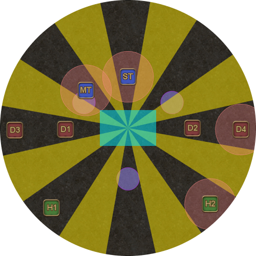
    </td>
  </tr>
  <tr>
    <td>
      
<b>25. </b>接著 Nael 登場，對 Twintania 階段結束時持有仇恨的坦克（通常是 ST）施放 <em>Dalamud Dive</em>，隨即接上五段 <em>Bahamut's Claw</em>。

      
請注意，<em>Dalamud Dive</em> 是範圍型坦克死刑，因此其他玩家應遠離 ST。

      <ul>
        <li><b>ST：</b>用無敵技能承受 Dalamud Dive。</li>
      </ul>
    </td>
    <td>
      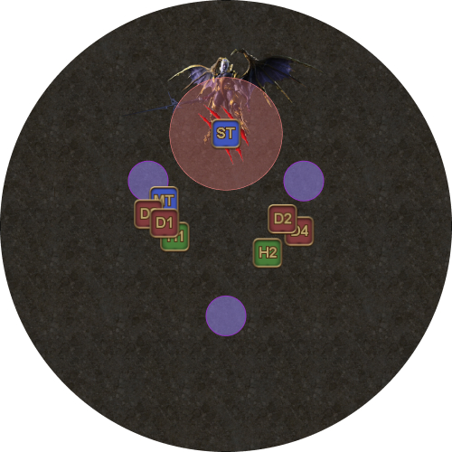
    </td>
  </tr>
</table>

---

## 常見問題

  <b>[Fireballs]</b> 為什麼戰鬥開始時只有 5 人分攤 Fireballs？

<table>
  <tr>
    <td>
      
這樣做有助於累積 LB。

      
為了從 Nael 轉場至 Bahamut，至少需要 Tank LB2 才能讓隊伍存活。不過，隨著時間推移 DPS 檢定已變得較寬鬆，若全隊分攤 <em>Fireball</em> 傷害，可能會累積不到足夠的 LB。

      
最後階段的 <em>Fireball</em> 由全隊一起分攤；除非治療職非常熟悉處理方式，否則不值得因人數或減傷不足而冒著團滅風險。

    </td>
  </tr>
</table>

  <b>[Fireballs]</b> 為什麼一開始是 D3 不加入 <em>Fireball</em> 分攤，而不是需要詠唱並移動的 D4？

<table>
  <tr>
    <td>
      
這樣做是為了讓 D3 維持較高 HP，因為不久後 D3 會引導 <em>Liquid Hell</em>。

    </td>
  </tr>
</table>

  <b>[Fireballs]</b> 為什麼第一次 <em>Fireball</em> 分攤時，不對 Twintania 使用 <em>Reprisal/Feint/Addle</em>？

<table>
  <tr>
    <td>
      
隊員受到等於或高於目前 HP 的傷害，卻因減傷或護盾而存活時，隊伍就會累積 LB。

      
將 <em>Fireball</em> 傷害分攤給五名而非八名玩家，是刻意讓這五人承受「致命」傷害，再用護盾和減傷救下他們，藉此累積 LB。

      
不過其中有些細節——效果的結算順序如下：

      <ol>
        <li>套用降低敵方傷害的減益效果 <em>(Addle、Dismantle、Feint、Reprisal)</em></li>
        <li><b>若傷害等於或高於目前 HP，則累積 LB</b></li>
        <li>套用減傷以降低受到的傷害 <em>(Aquaveil、Kerachole、Sacred Soil、Third Eye 等)</em></li>
        <li>由護盾吸收傷害 <em>(Divine Veil、Shade Shift、Succor 等)</em></li>
      </ol>
      
若在步驟 1 套用過多減益效果，步驟 2 的傷害便<em>不再致命</em>，因此<em>不會累積 LB</em>，也就失去 5 人 <em>Fireball</em> 分攤的目的。

    </td>
  </tr>
</table>

---

## 問題排解

  <b>[Hatch + Liquid Hell]</b> 光球太久才到我這裡，結果我站在火圈裡死亡。是哪裡出問題了？

<table>
  <tr>
    <td>
      
在 Twintania 開始施放 <em>Liquid Hells</em> 之前，光球就會開始朝玩家移動。這段時間內，光球應該會抵達 Neurolinks 內的玩家。

      
如果光球花太久才抵達，可能是被點名的玩家讓光球繞了太多彎（增加移動距離），或是 Neurolinks 離 Twintania 太遠（標記間距過大）。

    </td>
  </tr>
</table>

