# Nael deus Darnus

Nael 的難點之一是，雖然在 *Cauterize* 前會有三句台詞，但 Fire/Ice/Lightning 循環共有 *四輪*，因此兩個循環不會同步。

另一個難點是，Nael 階段的節奏比 Twintania 或大多數其他戰鬥都*明顯*更快。閱讀下方圖示時請記住這點——各機制會依序快速接連發生。

---

## 台詞

Nael 會以台詞預告接下來的攻擊；台詞中的關鍵字會指出她即將施放哪些攻擊，以及施放順序。

Nael 在此階段會說出以下台詞：

<table>
  <tr>
    <td>O <b>hallowed moon</b>, take <b>fire</b> and scorch my foes!</td>
    <td>
      
Lunar Dynamo → Thermionic Beam

      
<em>靠近 → 集合分攤</em>

    </td>
  </tr>
  <tr>
    <td>O <b>hallowed moon</b>, shine you the <b>iron</b> path!</td>
    <td>
      
Lunar Dynamo → Iron Chariot

      
<em>靠近 → 遠離</em>

    </td>
  </tr>
  <tr>
    <td>Take <b>fire</b>, O <b>hallowed moon</b>!</td>
    <td>
      
Thermionic Beam → Lunar Dynamo

      
<em>集合分攤 → 靠近</em>

    </td>
  </tr>
  <tr>
    <td><b>Blazing</b> path, lead me to <b>iron</b> rule!</td>
    <td>
      
Thermionic Beam → Iron Chariot

      
<em>集合分攤 → 遠離</em>

    </td>
  </tr>
  <tr>
    <td>From on high I <b>descend</b>, the <b>hallowed moon</b> to call!</td>
    <td>
      
Raven's Dive → Lunar Dynamo

      
<em>分散 → 靠近</em>

    </td>
  </tr>
  <tr>
    <td>
      
From on high I <b>descend</b>, the <b>iron</b> path to call!

      
From on high I <b>descend</b>, the <b>iron</b> path to walk!

    </td>
    <td>
      
Raven's Dive → Iron Chariot

      
<em>分散 → 遠離</em>

    </td>
  </tr>
  <tr>
    <td>Fleeting light! 'Neath the <b>red moon</b>, <b>scorch</b> you the 
    earth!</td>
    <td>
      
Dalamud Dive → Thermionic Beam

      
<em>坦克死刑 → 集合分攤</em>

    </td>
  </tr>
  <tr>
    <td>Fleeting light! Amid a rain of <b>stars</b>, exalt you the <b>red 
    moon!</b></td>
    <td>
      
Meteor Stream →　Dalamud Dive

      
<em>分散 → 坦克死刑</em>

    </td>
  </tr>
</table>

---

## Bahamut's Favor

<table>
  <tr>
    <td width="50%">
      
<b>1.</b> MT 在 <em>Bahamut's Claw</em> 結束後對 Nael 使用 Provoke，將 Nael 拉至中央並面向北方。

    </td>
    <td>
      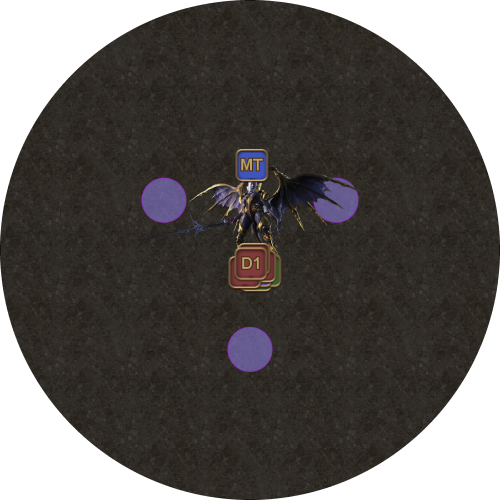
    </td>
  </tr>
  <tr>
    <td>
      
<b>2.</b> Nael 施放 <em>Bahamut's Favor</em>，召喚五隻龍出現在場地周圍。

      
接下來許多機制都與這些龍有關。

    </td>
    <td>
      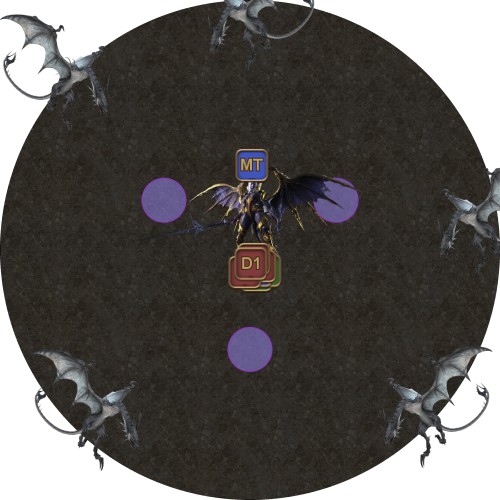
    </td>
  </tr>
</table>

<b>[點擊展開] 龍族機制說明</b>

<table>
  <tr>
    <td style="text-align:center">
      
      
    </td>
    <td>
      
<b>Firescorched 與 Icebitten</b>

      <ul>
        <li>
          
其中一隻龍會定期連線至一名隨機玩家，經過一段時間後以 Fire AoE 攻擊該玩家，並對所有被擊中的玩家附加 Fire 減益。

          
若玩家身上有 Ice 減益，兩者會互相抵銷；若玩家已經有 Fire，則會因此死亡。

        </li>
        <li>
          
另一隻龍會依隊伍名單順序輪流攻擊玩家，附加 Ice 減益。

          
若玩家身上有 Fire 減益，兩者會互相抵銷；若玩家已經有 Ice，則會因此死亡。

        </li>
      </ul>
    </td>
  </tr>
  <tr>
    <td style="text-align:center">
      
    </td>
    <td>
      
<b>Doom 與 Wings of Salvation</b>

      
其中一隻龍會對 2–3 名玩家施加 Doom，倒數結束時會使玩家死亡。Doom 的倒數時間錯開，會依序在 6 秒、11 秒和 16 秒後結束。

      
另一隻龍會針對每個 Doom 減益各選中一名隨機玩家，以白色 <em>Wings of Salvation</em> AoE 攻擊，並在地面留下小型白圈。

      
移除 Doom 的唯一方法，是踏入 <em>Wings of Salvation</em> 爆炸後留下的小型白圈。

      
由於 Doom 的倒數時間錯開，必須依正確順序解除。

    </td>
  </tr>
  <tr>
    <td style="text-align:center">
      
    </td>
    <td>
      
<b>Thunderstruck</b>

      
最後一隻龍會定期以 Thunder 點名兩名隨機隊員。這項減益會在該玩家周圍以 AoE 爆發，造成傷害並麻痺所有被擊中的<em>其他</em>玩家。

    </td>
  </tr>
</table>

---

## 第一句台詞

Nael 第一句台詞的機制順序如下：

1. Lunar Dynamo + Thunder
2. Iron Chariot *或* Thermionic Beam
3. Wings of Salvation #1 + Fire（靠近）
4. Wings of Salvation #2
5. Bahamut's Claw

<table>
  <tr>
    <td width="50%">
      
<b>3.</b> Nael 會說出第一句台詞，接著施放以下其中一種組合：

      <ul>
        <li>Lunar Dynamo → Iron Chariot</li>
        <li>Lunar Dynamo → Thermionic Beam</li>
      </ul>
      
兩名隨機玩家會被附加 Thunder 減益；這兩名玩家必須與隊伍分開，但仍留在 <em>Lunar Dynamo</em> 的安全區域內。

      
站位優先順序如下：

      <ul>
        <li><b>左：</b> MT ST H1 H2 D1 D2 D3 D4 <b>：右</b></li>
      </ul>
    </td>
    <td>
      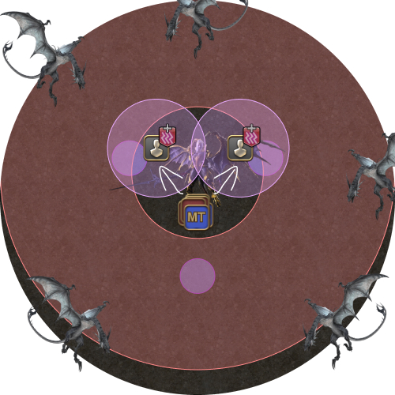
    </td>
  </tr>
  <tr>
    <td>
      
<b>4.</b> <em>Lunar Dynamo</em> 結束後，依情況集合分攤 <em>Thermionic Beam</em>，或遠離 Nael 躲避 <em>Iron Chariot</em>。

    </td>
    <td>
      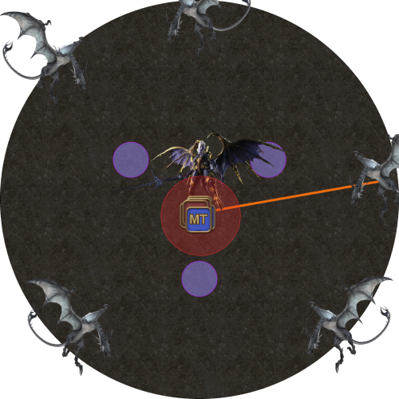
      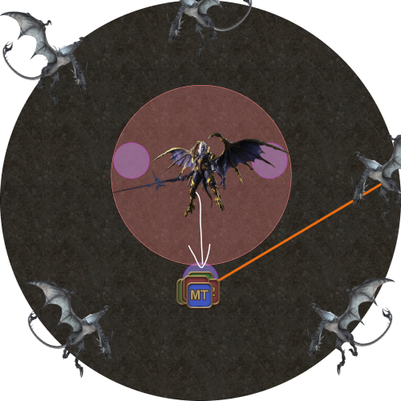
    </td>
  </tr>
  <tr>
    <td>
      
<b>5.</b> 全隊一起用同一個方向躲避白色 AoE，並讓隊伍承受 <em>Fireball</em>。

    </td>
    <td>
      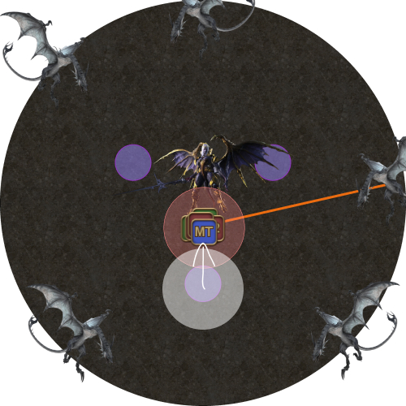
    </td>
  </tr>
  <tr>
    <td>
      
<b>6.</b> 躲避第二個白色 AoE。

      <ul>
        <li><b>6 秒 Doom：</b>解除自己的 Doom。</li>
      </ul>
    </td>
    <td>
      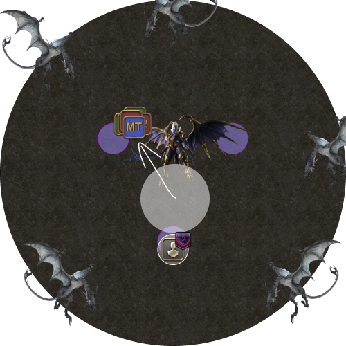
    </td>
  </tr>
  <tr>
    <td>
      
<b>7.</b> 第二次 <em>Wings of Salvation</em> 判定，並留下第二個白圈。

      <ul>
        <li><b>10 秒 Doom：</b>解除自己的 Doom。</li>
      </ul>
    </td>
    <td>
      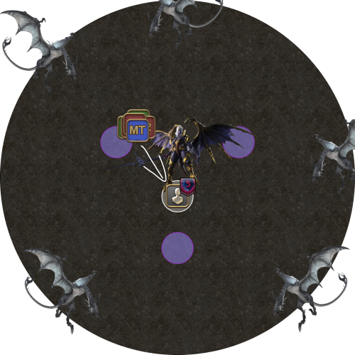
    </td>
  </tr>
  <tr>
    <td>
      
<b>8.</b> Nael 對 MT 施放五段 <em>Bahamut's Claw</em>。

    </td>
    <td>
      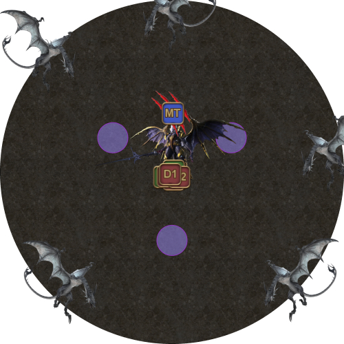
    </td>
  </tr>
</table>

---

## 第二句台詞

這可能是此階段最忙亂的一連串機制：

1. Fire（遠離）
2. Thunder
3. Thermionic Beam
4. Lunar Dynamo *或* Iron Chariot
5. Wings of Salvation #1
6. Wings of Salvation #2
7. Wings of Salvation #3 + Thunder
8. Fire（靠近）
9. Bahamut's Claw

<table>
  <tr>
    <td width="50%">
      
<b>9.</b> 第二條 Fire 連線出現。

      <ul>
        <li><b>第二次 Fire：</b>遠離隊伍，獨自承受 <em>Fireball</em>。</li>
        <li><b>其他玩家：</b>若你有 <em>Icebitten</em> 減益（也就是沒吃到第一次 <em>Fireball</em>），請與第二次 Fire 的玩家集合，移除 <em>Icebitten</em>。</li></ul>
    </td>
    <td>
      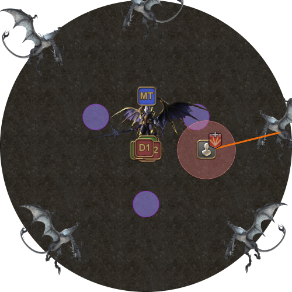
    </td>
  </tr>
  <tr>
    <td>
      
<b>10.</b> Nael 會說出第二句台詞，接著施放以下其中一種組合：

      <ul>
        <li>Thermionic Beam → Lunar Dynamo</li>
        <li>Thermionic Beam → Iron Chariot</li>
      </ul>
      
同時，兩個 <em>Thunderstruck</em> 減益會判定。

      <ul>
        <li><b>Thunder：</b>遠離隊伍，且彼此不要重疊。</li>
      </ul>
    </td>
    <td>
      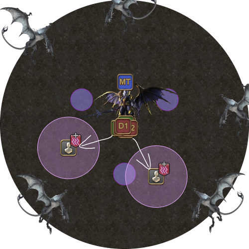
    </td>
  </tr>
  <tr>
    <td>
      
<b>11.</b> Nael 第二句台詞的第一個機制。

      
在中央集合分攤 <em>Thermionic Beam</em>。

    </td>
    <td>
      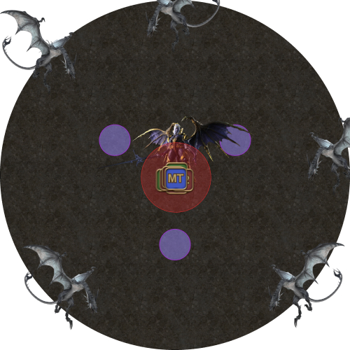
    </td>
  </tr>
  <tr>
    <td>
      
<b>12.</b> Nael 第二句台詞的第二個機制。

      <ul>
        <li>待在內側並集合以躲避 <em>Lunar Dynamo</em>，或是</li>
        <li>往後退以躲避 <em>Iron Chariot</em>。</li>
      </ul>
    </td>
    <td>
      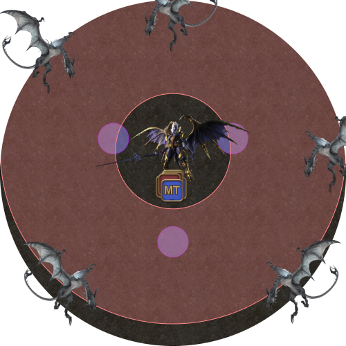
      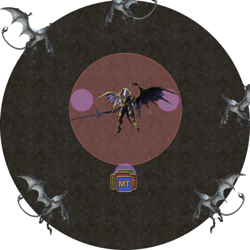
    </td>
  </tr>
  <tr>
    <td>
      
<b>13.</b> 第一次 <em>Wings of Salvation</em> 判定，同時出現 <em>三個</em> Doom，倒數分別為 6 秒、10 秒和 14 秒。

    </td>
    <td>
      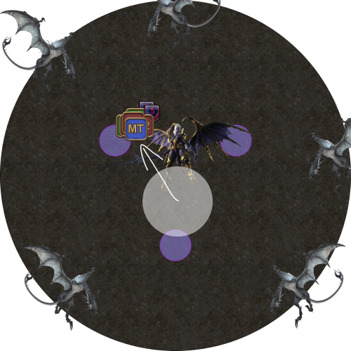
    </td>
  </tr>
  <tr>
    <td>
      
<b>14.</b> 第二次 <em>Wings of Salvation</em> 判定。

      
兩名隨機玩家會被 Thunderstruck 點名。

      <ul>
        <li><b>6 秒 Doom：</b>解除自己的 Doom 減益。</li>
      </ul>
    </td>
    <td>
      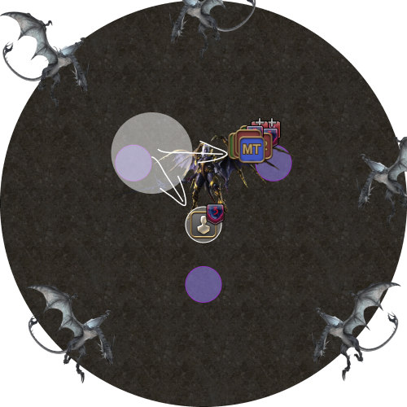
    </td>
  </tr>
  <tr>
    <td>
      
<b>15.</b> 第三次 <em>Wings of Salvation</em> 與兩個 <em>Thunderstruck</em> 減益同時判定。

      
Fire 龍會隨機以一名玩家為 <em>Fireball</em> 連線目標。

      <ul>
        <li><b>10 秒 Doom：</b>解除自己的 Doom 減益。</li>
      </ul>
    </td>
    <td>
      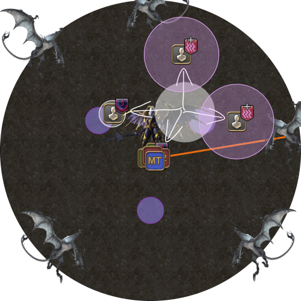
    </td>
  </tr>
  <tr>
    <td>
      
<b>16. 14 秒 Doom：</b>解除自己的 Doom 減益。

    </td>
    <td>
      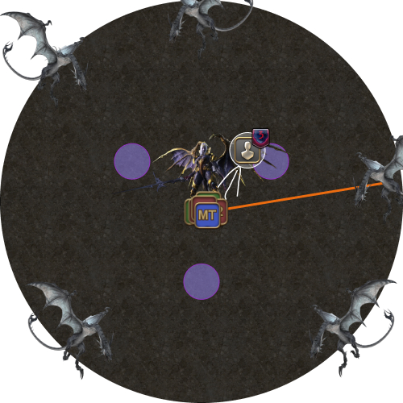
    </td>
  </tr>
  <tr>
    <td>
      
<b>17.</b> 第三次 <em>Fireball</em> 判定。

      
所有人集合以取得 <em>Firescorched</em> 減益，<b>第二次 Fire 的玩家除外。</b>

    </td>
    <td>
      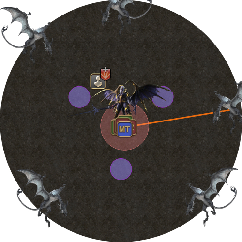
    </td>
  </tr>
  <tr>
    <td>
      
<b>18.</b> 分散站位，準備處理 Nael 的第三句台詞。

      
Nael 會對 MT 施放 Bahamut's Claw。

    </td>
    <td>
      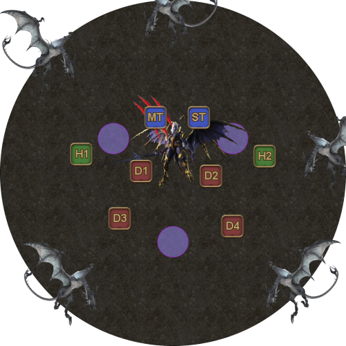
    </td>
  </tr>
</table>

請小心，因為*所有*機制都有可能同時選中同一名玩家：



---

## 第三句台詞

Nael 第三句台詞的機制順序如下：

1. 分散
2. Lunar Dynamo *或* Iron Chariot
3. Wings of Salvation #1 + Fire → Thunder
4. Wings of Salvation #2
5. Wings of Salvation #3
6. Ravensbeak

<table>
  <tr>
    <td width="50%">
      
<b>19.</b> Nael 會說出第三句台詞，接著施放以下其中一種組合：

      <ul>
        <li>Raven Dive → Lunar Dynamo</li>
        <li>Raven Dive → Iron Chariot</li>
      </ul>
      
Nael 第三句台詞的第一個機制判定。

      
Nael 會俯衝攻擊一名隨機玩家，並以 AoE 將其他被擊中的玩家擊出場外。

      
Fire 龍也會連線至一名隨機玩家。

    </td>
    <td>
      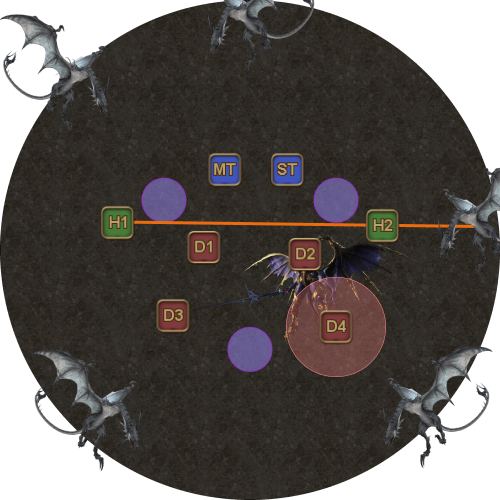
    </td>
  </tr>
  <tr>
    <td>
      
<b>20.</b> Nael 第三句台詞的第二個機制判定，可能為以下其中一種：

      <ul>
        <li>靠近 Nael 躲避 <em>Lunar Dynamo</em>，或是</li>
        <li>遠離 Nael 躲避 <em>Iron Chariot</em>。</li>
      </ul>
      
兩名隨機玩家會被 <em>Thunderstruck</em> 點名。

    </td>
    <td>
      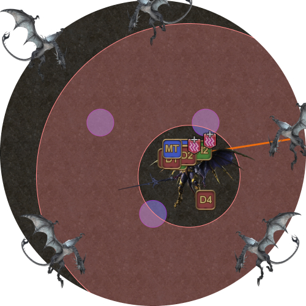
      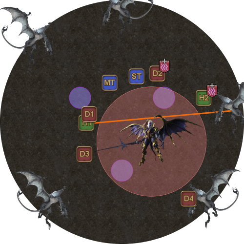
    </td>
  </tr>
  <tr>
    <td>
      
<b>21.</b> 第四次 Fire 判定時，第一個 <em>Wings of Salvation</em> AoE 也會出現。

    </td>
    <td>
      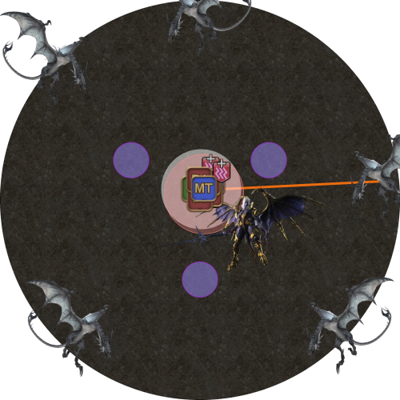
    </td>
  </tr>
  <tr>
    <td>
      
<b>22.</b> 維持集合，直到取得 Fire 減益後，再躲避 <em>Wings of Salvation</em> AoE。

      <ul>
        <li><b>沒有 Thunder 的玩家：</b>朝 Nael 方向躲避，但停在 <em>Wings of Salvation</em> 範圍外。</li>
        <li><b>有 Thunder 的玩家：</b>遠離 Nael（也就是遠離隊伍）。</li>
      </ul>
    </td>
    <td>
      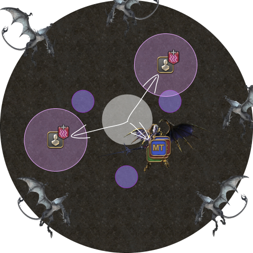
    </td>
  </tr>
  <tr>
    <td>
      
<b>23.</b> 第二個 Wings of Salvation 出現。

      <ul>
        <li><b>6 秒 Doom：</b>解除自己的 Doom。</li>
      </ul>
    </td>
    <td>
      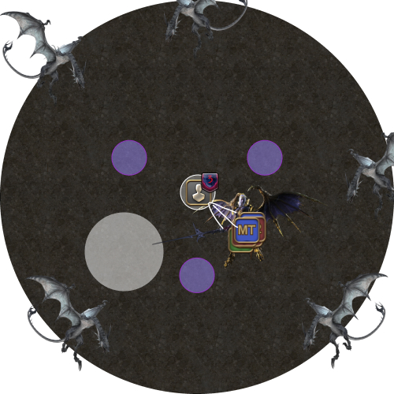
    </td>
  </tr>
  <tr>
    <td>
      
<b>24.</b> 第三個 Wings of Salvation 出現。

      <ul>
        <li><b>10 秒 Doom：</b>解除自己的 Doom。</li>
      </ul>
    </td>
    <td>
      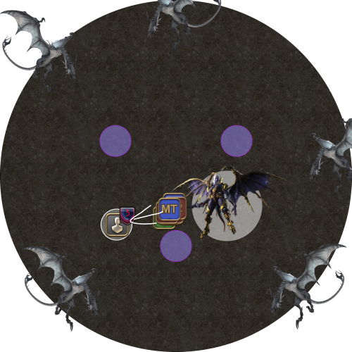
    </td>
  </tr>
  <tr>
    <td>
      
<b>25. </b>由 MT 將 Nael 拉回中央並面向北方。

      <ul>
        <li><b>14 秒 Doom：</b>解除自己的 Doom。</li>
      </ul>
    </td>
    <td>
      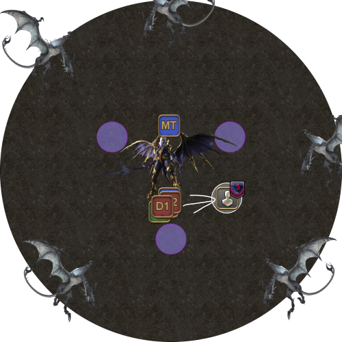
    </td>
  </tr>
  <tr>
    <td>
      
<b>26. </b>接著 Nael 會以 <em>Ravensbeak</em> 點名 MT。這是單體坦克死刑，並會附加 <em>Piercing Resistance Down II</em> 減益，因此必須換坦。

    </td>
    <td>
      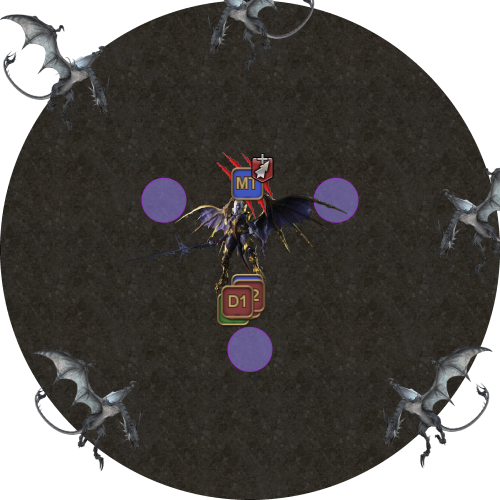
    </td>
  </tr>
</table>

---

## 第四句台詞（Cauterize）

隊伍必須同時處理 Nael 的第四句台詞與俯衝轟炸。

- 三名隨機玩家（目前持有仇恨的坦克除外）會被綠色標記點名。
- 當標記*消失*時，準備俯衝的龍會鎖定該玩家當時所在的位置，接著朝該位置俯衝。
- 總共有三輪俯衝，分別以 2-1-2 隻龍的順序進行：
  - 從北方（包含正北）開始，順時針數的前兩隻龍。
  - 從北方開始順時針數的第三隻龍。
  - 從北方開始順時針數的最後兩隻龍。
- 目標是將俯衝轟炸引導至遠離場地中央（隊伍所在位置）的方向。
- Nael 也會在前兩名引導者的位置施放 Hypernova AoE。

可以使用這個網站練習俯衝轟炸的站位：

[https://freehaha.github.io/nael-dive/](https://freehaha.github.io/nael-dive/)

<table>
  <tr>
    <td width="50%">
      
<b>27.</b> Nael 會說出第四句台詞，接著施放以下其中一種組合：

      <ul>
        <li>Meteor Stream → Dalamud Dive</li>
        <li>Dalamud Dive → Thermionic Beam</li>
      </ul>
      
<em>（請注意，這是第一句第一個機制<em>並非</em>固定的台詞。）</em>

      
同時，第一個俯衝轟炸標記會出現在 ST（目前持有仇恨）以外的玩家頭上。

    </td>
    <td>
      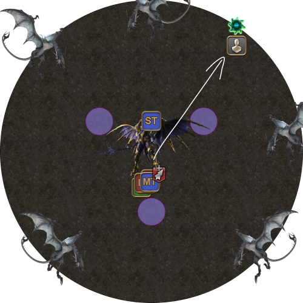
    </td>
  </tr>
  <tr>
    <td>
      
<b>28.</b> 第一個俯衝轟炸標記消失，鎖定第一個俯衝轟炸位置；同時 Nael 會以兩個 <em>Supernova</em> AoE 攻擊該玩家。

      
第二個俯衝轟炸標記出現在另一名玩家頭上。

    </td>
    <td>
      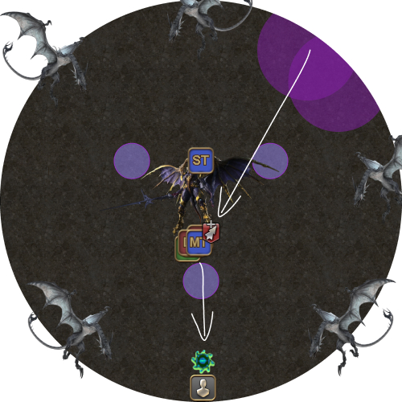
    </td>
  </tr>
  <tr>
    <td>
      
<b>29.</b> 第二個俯衝轟炸標記消失，鎖定第二個俯衝轟炸位置；同時 Nael 會以兩個 <em>Supernova</em> AoE 攻擊該玩家。

      
第三個俯衝轟炸標記出現在另一名玩家頭上。

    </td>
    <td>
      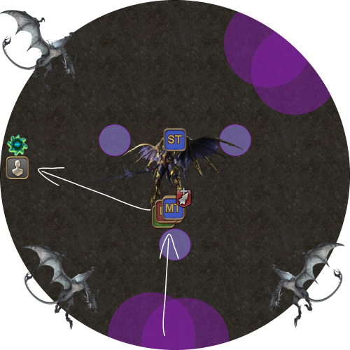
    </td>
  </tr>
  <tr>
    <td>
      
<b>30.</b> Nael 消失，第一輪俯衝轟炸判定。

      
第三個俯衝轟炸標記消失，鎖定第三個俯衝轟炸位置。

    </td>
    <td>
      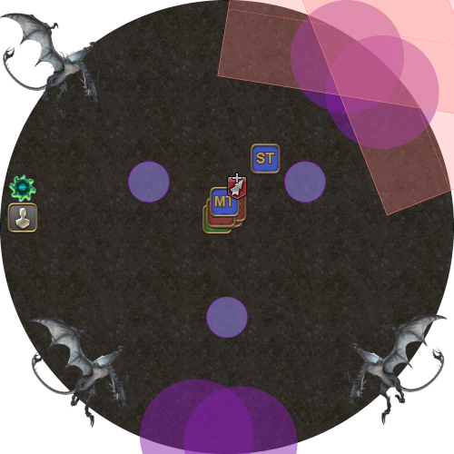
    </td>
  </tr>
  <tr>
    <td>
      
<b>31.</b> Nael 第四句台詞的第一個機制判定，可能為以下其中一種：

      <ul>
        <li>分散躲避 <em>Meteor Stream</em>，或</li>
        <li>在中央集合分攤 <em>Thermionic Beam</em>。</li>
      </ul>
      
由於第一輪俯衝轟炸已經判定，第一輪轟炸區域周圍通常可安全分散。

      
隊伍也應避開 ST。

    </td>
    <td>
      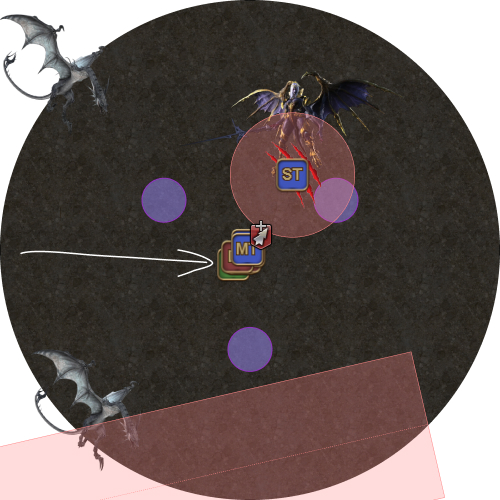
      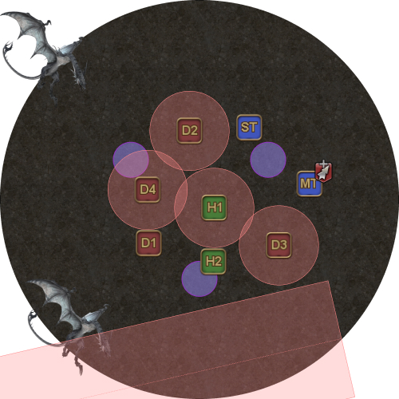
    </td>
  </tr>
  <tr>
    <td>
      
<b>32.</b> Nael 第四句台詞的第二個機制判定。

      
隊伍應在中央集合，這樣能同時應對以下兩種情況：

      <ul>
        <li>ST 受到 <em>Dalamud Dive</em> 攻擊，或</li>
        <li>集合分攤 <em>Thermionic Beam</em>。</li>
      </ul>
      
若 Nael 第二個施放的是 <em>Thermionic Beam</em>，ST 也可以加入分攤，以分擔傷害。

      
第三輪俯衝轟炸也會在此時判定。

    </td>
    <td>
      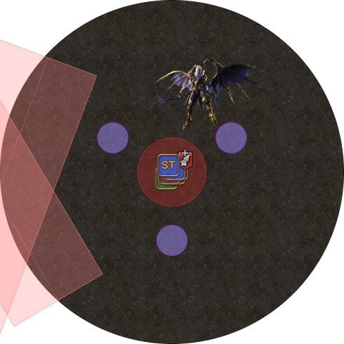
      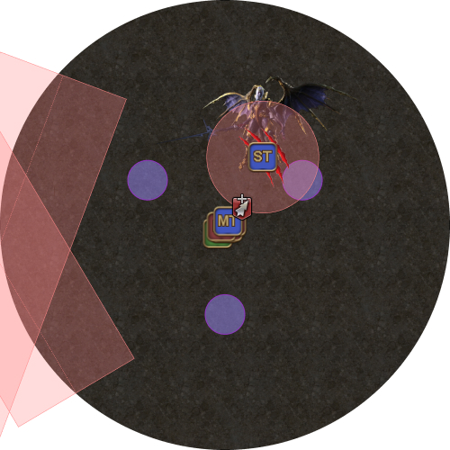
    </td>
  </tr>
  <tr>
    <td>
      
<b>33.</b> 接著 Nael 會對 ST 施放五段 <em>Bahamut's Claw</em>，與階段開始時的流程相同。

    </td>
    <td>
      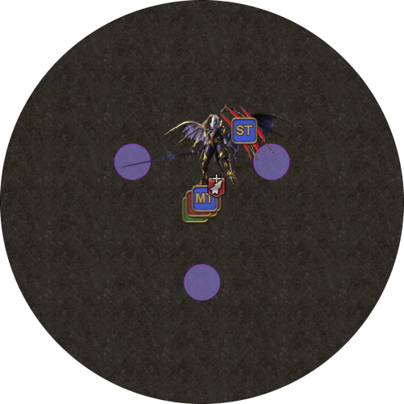
    </td>
  </tr>
</table>

---

## 第五、六句台詞

從這裡開始，機制順序如下：

1. Nael 的第五句台詞
2. Nael 的第六句台詞
3. Ravensbeak（換坦）
4. Bahamut's Claw（五段坦克死刑）
5. Megaflare（狂暴）

第五、六句台詞會從 Nael 前三句台詞中隨機挑選組合。

現在龍已離場，處理起來簡單許多，隊伍不再需要應付 Fire/Ice、Thunder 或 Doom。

---

## Seventh Umbral Era（轉場至 Bahamut）

根據隊伍在 Twintania 和 Nael 階段的 LB 累積情況，此時應該會有 Tank LB2 或 LB3 可用。

全隊在南側 Neurolink 集合（與轉場至 Nael 時集合的位置相同），準備承受擊退。

- 若有 LB2：在擊退**之前**施放 Tank LB。
- 若有 LB3：在擊退**時**施放 Tank LB。

接著，巨大火球會脈動四次，對全隊造成傷害——先是三次較弱的脈動 *(Calamitous Flame)*，最後是一次強力脈動 *(Calamitous Blaze)*。

### 回復 LB3

如果 Nael 階段結束時有 LB3，學會如何利用機制「偷」過 *Seventh Umbral Era* 可能會很有幫助，讓你們以 LB3（或至少非常接近 LB3）的狀態開始 *Quickmarch Trio*，尤其是在開荒 Bahamut 時。

這樣一來，原本可能團滅的戰局便能用治療職 LB3 挽救，讓隊伍多一些練習機會。



當隊員受到足以致命的傷害，卻靠護盾或減傷（此處為 Tank LB3）存活時，就會累積 LB。Twintania 階段以 5 人分攤 *Fireball* 來累積 LB，也是相同原理：減少分攤人數，使傷害提高至致命程度，再靠護盾救下隊員。

*Seventh Umbral Era* 的擊退傷害取決於玩家與場地中心的距離。

目標是讓 HP 降至約 4,000–6,000；若沒有 Tank LB3，這個血量會被 *Calamitous Flame* 擊殺。如果受到的傷害太低，可以考慮移除護盾或站得更靠近中心。

使用 Tank LB3（80% 減傷）時，每次較弱的 *Calamitous Flame* 脈動約造成 1,300 傷害，而 *Calamitous Blaze* 造成略低於 5,500 傷害。

治療職應提早開始詠唱，確保能在 *Calamitous Blaze* 前完成治療；但要留意擊退後 HP 過低（低於 4,000）的隊員，否則他們可能會被三次 *Calamitous Flames* 擊殺。

---

## 常見問題

  <b>[Iron Chariot/Raven Dive]</b> 可以用防擊退技能抵抗這些機制嗎？

<table>
  <tr>
    <td>
      
不行，<em>Arm's Length/Surecast</em> 無法抵抗。

      
不過坦克可以抓準時機使用突進技能返回場內（因為坦克能承受該傷害）。

    </td>
  </tr>
</table>

