# 巴哈姆特本體

巴哈姆特階段是一連串「Trio」機制的考驗（這個名稱也由此而來）。

Trio 本質上是一套機制連招，三隻首領 
（Twintania、Nael、Bahamut）的機制會同時執行。

---

## Quickmarch Trio

巴哈姆特開場會先施放 Flare Breath，接著使用 Flatten（並進行一次自動攻擊），然後 
開始第一組 Trio。

<table>
  <tr>
    <td width="50%">
      
<b>1.</b> 以三隻龍所在方向為北，沿場地西側和東側散開。

      <ul>
        <li><b>MT 組：</b> 西側</li>
        <li><b>ST 組：</b> 東側</li>
      </ul>
      
從龍的位置開始，依照以下順序散開：

      <ul>
        <li>坦克 > 治療 > 近戰 > 遠程</li>
      </ul>
      
注意中間位置與上、下方位置之間的空隙。坦克（尤其是）遠程可能難以判斷俯衝範圍的邊界。他們不需要緊貼俯衝範圍；治療和近戰只要有足夠空間沿邊緣躲避即可。

    </td>
    <td>
      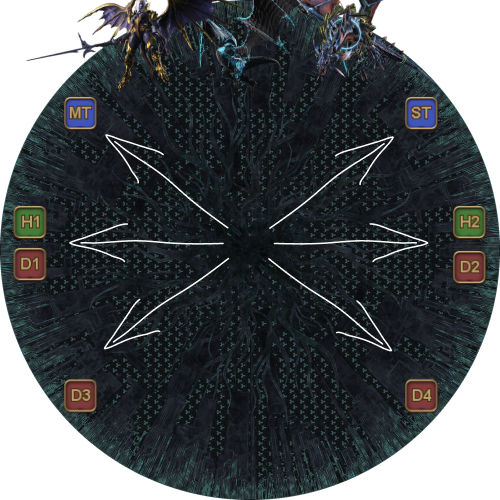
    </td>
  </tr>
  <tr>
    <td>
      
<b>2.</b> Bahamut 施放完 Megaflare Dive 後，所有玩家沿著場地邊緣移動以躲避 Twisters。

    </td>
    <td>
      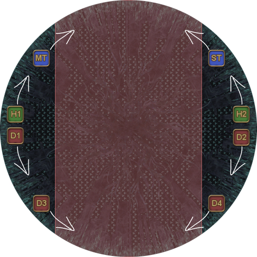
    </td>
  </tr>
  <tr>
    <td>
      
<b>3.</b> 四名隨機玩家腳下會出現大型 Megaflare AoE。

      
另外也會有四名隨機玩家受到沒有預兆的 Megaflare AoE 攻擊 <em>（同一名玩家可能同時被選中）</em>.

    </td>
    <td>
      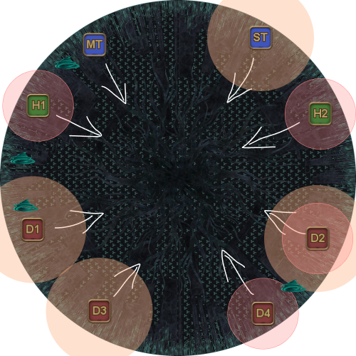
    </td>
  </tr>
  <tr>
    <td>
      
<b>4.</b> Bahamut 現身並連結兩名隨機（非坦克）玩家。

      
三名 DPS 玩家身上會出現白色 Megaflare 圓環標記。

      <ul>
        <li><b>若你有標記：</b> 到南側集合。</li>
        <li><b>若你沒有標記：</b> 到北側。</li>
      </ul>
      
有預兆的 Megaflare AoE 也會在此時爆炸。

      
治療需要把 DPS 組的血量補滿，因為他們可能在上一個步驟受到 Megaflare AoE 攻擊。

    </td>
    <td>
      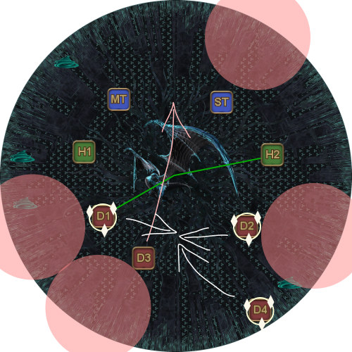
    </td>
  </tr>
  <tr>
    <td>
      
<b>5.</b> 兩名治療以及上一個步驟中沒有 Megaflare 標記的 DPS 會出現 Earthshaker 標記。

      
Megaflare 分攤會隨機命中三名被標記玩家中的一人，三名 DPS 應一起分攤。

      
坦克應在這次 Megaflare 分攤前或緊接著分攤後接下 Tempest Wing 連線。

    </td>
    <td>
      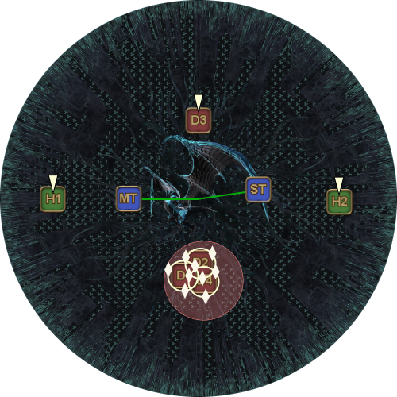
    </td>
  </tr>
  <tr>
    <td>
      
<b>6.</b> Earthshakers 結算。

      
坦克站在治療前方；只要沒有同時被兩道 Earthshaker 命中，受到的傷害就會很低。

    </td>
    <td>
      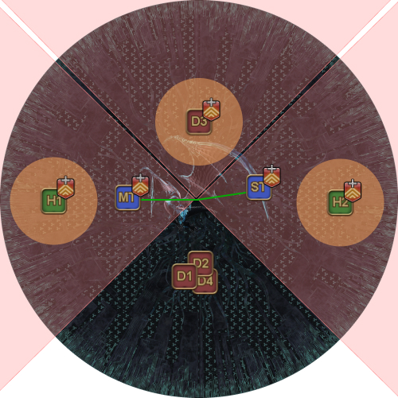
    </td>
  </tr>
  <tr>
    <td>
      
<b>7.</b> Tempest Wings 結算。

    </td>
    <td>
      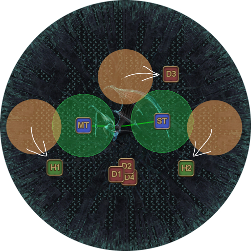
    </td>
  </tr>
</table>

---

## Blackfire Trio

Quickmarch Trio 結束後，巴哈姆特會再次施放 Flare Breath 和 Flatten，接著進入第二組 Trio。

<table>
  <tr>
    <td width="50%">
      
<b>1.</b> 在場地中央集合，並確認 Nael 的位置。

      
一名玩家會被標記為 Bahamut 俯衝的目標。

      

      <b>提示：</b> Nael 一定在 Bahamut 的順時針方向，並在 Twintania 的逆時針方向。

    </td>
    <td>
      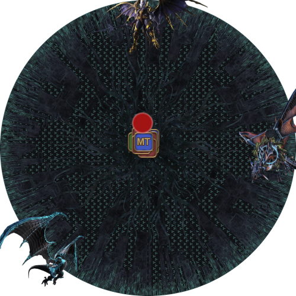
    </td>
  </tr>
  <tr>
    <td>
      
<b>2.</b> 從中央朝 Nael 方向分段移動，沿途引導 Twintania 的 Liquid Hell。

      
大約第三次 Liquid Hell 時，Nael 會對一名隨機玩家施放 Thermionic Beam。

    </td>
    <td>
      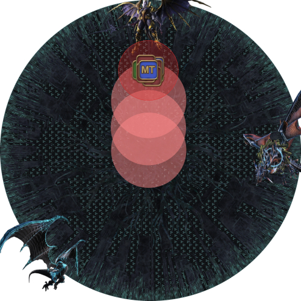
    </td>
  </tr>
  <tr>
    <td>
      
<b>3.</b> 大約第五次 Liquid Hell 時，Bahamut 的俯衝會結算；應已將其引導穿過場地中央。

    </td>
    <td>
      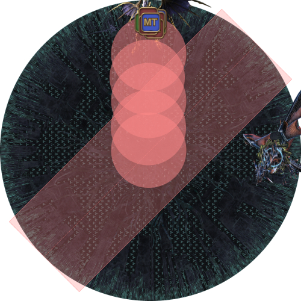
    </td>
  </tr>
  <tr>
    <td>
      
<b>4.</b> 以 Nael 的位置為基準，四座塔出現。

      
隊伍分成兩組：

      <ul>
        <li>坦克和治療到場地邊緣向左轉。</li>
        <li>DPS 到場地邊緣向右轉。</li>
      </ul>
      
一名坦克、一名治療和兩名 DPS 會出現 Megaflare 圓環標記。這些玩家要在 Nael 對面的兩座塔之間集合。

      
以 Nael 所在方向為北，沒有 Megaflare 標記的玩家要站在指定塔旁（不可站進塔內！）：

      <ul>
        <li><b>坦克</b> → 西北塔。</li>
        <li><b>治療</b> → 西南塔。</li>
        <li><b>DPS</b> → NE：D1 D2 D3 D4：東南塔</li>
      </ul>
    </td>
    <td>
      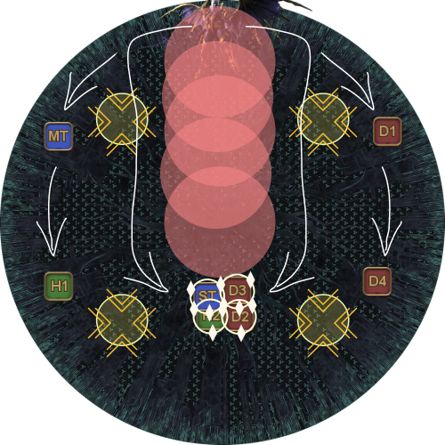
    </td>
  </tr>
  <tr>
    <td>
      
<b>5.</b> 接著 Nael 會以 Hypernova AoE 攻擊隨機玩家。

      
<b>第二次 Hypernova 時</b>，Megaflare 分攤會結算，所有沒有 Megaflare 標記的玩家進入自己的塔。

    </td>
    <td>
      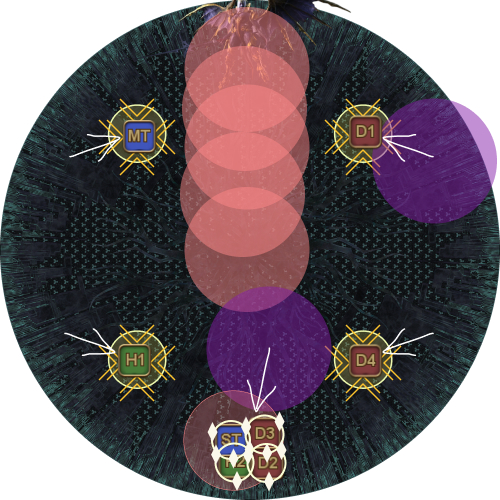
    </td>
  </tr>
  <tr>
    <td>
      
<b>6.</b> Bahamut 在場地中央再次出現並開始詠唱 Gigaflare，同時 Nael 放置第三、第四次 Hypernova AoE。

      
在 Bahamut 後方的中央集合。 <em>（小心 Hypernovas！）</em>

    </td>
    <td>
      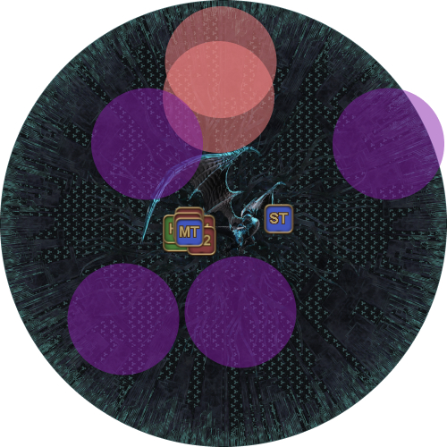
    </td>
  </tr>
</table>

---

## Fellruin Trio

Blackfire Trio 結束後，巴哈姆特會施放三次 Flare Breath，接著開始 Fellruin Trio。

Nael 可能說出以下兩句台詞：

<table>
  <tr>
    <td>From on high I <b>descend</b>, the <b>moon</b> and <b>stars</b> to 
    bring!</td>
    <td>
      
Raven's Dive → Lunar Dynamo → Meteor Stream

      
<em>Spread → In → (Neurolinks) → Spread</em>

    </td>
  </tr>
  <tr>
    <td>From <b>hallowed moon</b> I <b>descend</b>, a rain of <b>stars</b> to 
    bring!</td>
    <td>
      
Lunar Dynamo → Raven's Dive → Meteor Stream

      
<em>In → Spread → (Neurolinks) → Spread</em>

    </td>
  </tr>
</table>

注意，現在 Nael 的台詞會預告*三個*機制，而非兩個。

<table>
  <th width="34%"></th>
  <th width="33%">From hallowed moon I descend, a rain of stars to bring!</th>
  <th>From on high I descend, the moon and stars to bring!</th>
  <tr>
    <td>
      
<b>1.</b> 找到 Nael，並根據 Nael 的台詞選擇在她周圍集合或散開。

      
坦克應站在最靠近場地中央的位置。

    </td>
    <td>
      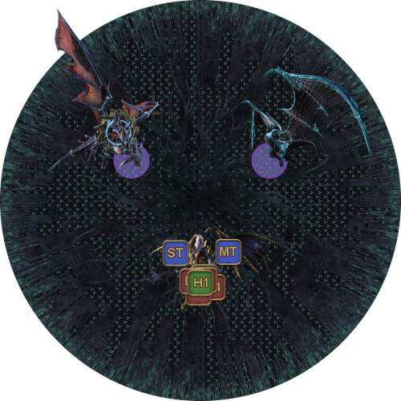
    </td>
    <td>
      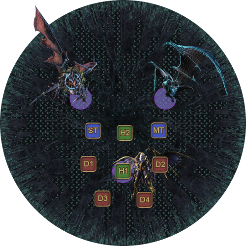
    </td>
  </tr>
  <tr>
    <td>
      
<b>2.</b> Nael 台詞預告的第一個機制結算。

      
Bahamut 放出 Tempest Wing 連線，連結兩名隨機玩家（坦克除外）。

    </td>
    <td>
      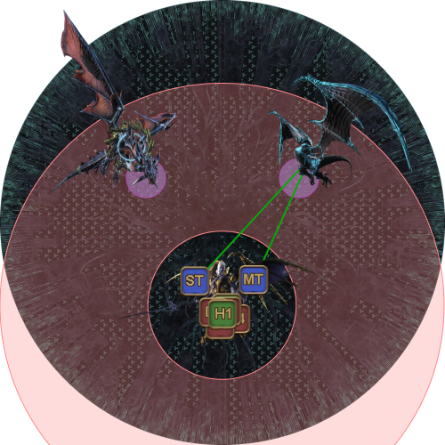
    </td>
    <td>
      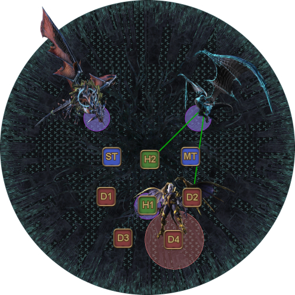
    </td>
  </tr>
  <tr>
    <td>
      
<b>3.</b> Nael 台詞預告的第二個機制結算。 <em>（這一定會是相反的機制。）</em>

      
此時坦克應已接下 Tempest Wing 連線。

    </td>
    <td>
      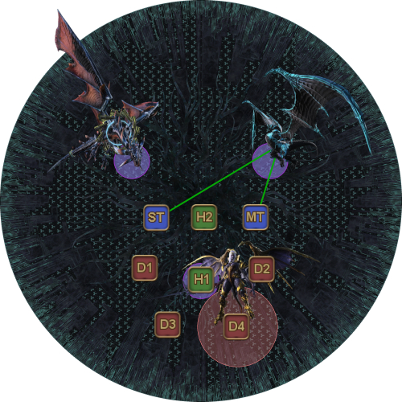
    </td>
    <td>
      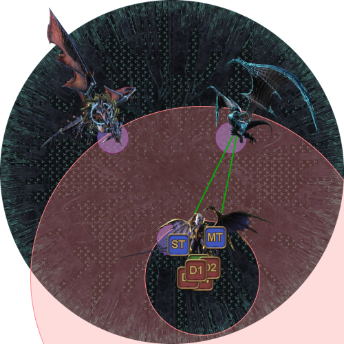
    </td>
  </tr>
</table>
<table>
  <tr>
    <td width="50%">
      
<b>4.</b> Twintania 的 Aetheric Profusion 與 Bahamut 的 Tempest Wing 一起結算。

      
所有玩家都必須站在 Neurolink 內。

    </td>
    <td colspan="2">
      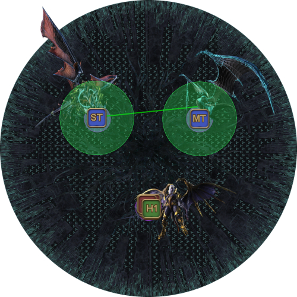
    </td>
  </tr>
  <tr>
    <td>
      
<b>5.</b> Nael 台詞預告的第三個機制結算；這一定是 Meteor Stream（四名隨機玩家腳下出現 AoE）。

      
如圖所示，在 Neurolink 周圍散開。

    </td>
    <td colspan="2">
      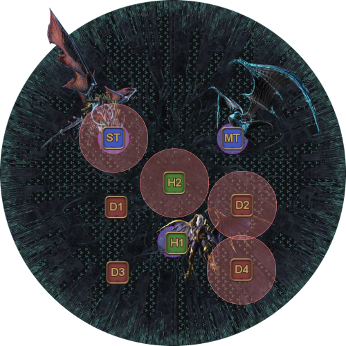
    </td>
  </tr>
</table>

---

## Heavensfall Trio

Blackfire Trio 結束後，巴哈姆特會*立刻*轉向對坦克施放 Flare Breath，接著施放 Flatten，再施放 Flare Breath。

之後巴哈姆特開始 Heavensfall Trio，戰鬥也進入中點。

<table>
  <tr>
    <td width="50%">
      
<b>1.</b> 在中央集合，並確認三隻首領的位置。

      
一名玩家會被標記為 Bahamut 俯衝目標，另一名玩家則會被標記為 Twintania 俯衝目標。

    </td>
    <td>
      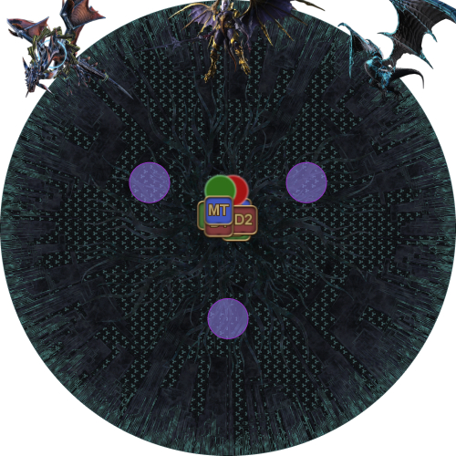
    </td>
  </tr>
  <tr>
    <td>
      
<b>2.</b> 依照以下方式散開：

      <ul>
        <li><b>MT, ST:</b> 靠近 Nael。</li>
        <li><b>H1, D1:</b> 在三隻首領的左側。</li>
        <li><b>H2, D2:</b> 在三隻首領的右側。</li>
        <li><b>D3, D4:</b> 在 Nael 對面。</li>
      </ul>
    </td>
    <td>
      
    </td>
  </tr>
</table>

最後的站位會像下方三張示意圖其中之一：

<table>
  <th width="33.3%" style="text-align:center">Nael 在左</th>
  <th width="33.3%" style="text-align:center">Nael 在中間</th>
  <th style="text-align:center">Nael 在右</th>
  <tr>
    <td>
      
    </td>
    <td>
      
    </td>
    <td>
      
    </td>
  </tr>
</table>

<table>
  <tr>
    <td width="50%">
      
<b>3.</b> Twintania 和 Bahamut 俯衝離開，Nael 留在原地。

      
沿場地邊緣移動以躲避 Twisters，並沿外側引導 Megaflare AoE，做法和 Quickmarch Trio 相同。

    </td>
    <td>
      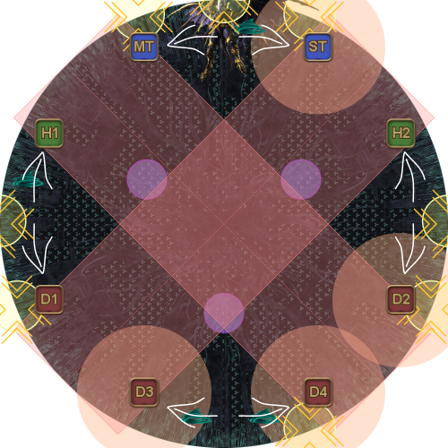
    </td>
  </tr>
  <tr>
    <td>
      
<b>4.</b> 場地邊緣會出現八座塔。

      
以 Nael 為基準找出自己的塔，並站在塔前。

      <ul>
        <li><b>逆時針（不含 Nael）：</b> MT H1 D1 D3</li>
        <li><b>順時針（含 Nael）：</b> ST H2 D2 D4</li>
      </ul>
      
<em>可能</em>有一座塔出現在 Nael 所在位置。若有，由 ST 負責該塔。

      
可用 Neurolink 粗略判斷應站得多靠近場地中央。

      
被擊退撞上牆會立即死亡，因此寧可選擇站得更靠近場地中央。

    </td>
    <td>
      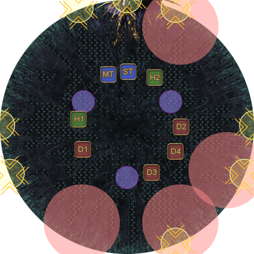
    </td>
  </tr>
  <tr>
    <td>
      
<b>5.</b> Heavensfall 塔在場地中央落下，將所有玩家擊退至場地邊緣、推入各自的塔中。

      
<em>（你大約有半秒可以調整位置。）</em>

      

        
<b>提示：</b> 使用坦克 LB3，隊伍最多可以漏掉兩座塔。

        
開荒時可以在此使用坦克 LB3，但之後的 <em>Grand Octet</em> 中就無法使用。

      

    </td>
    <td>
      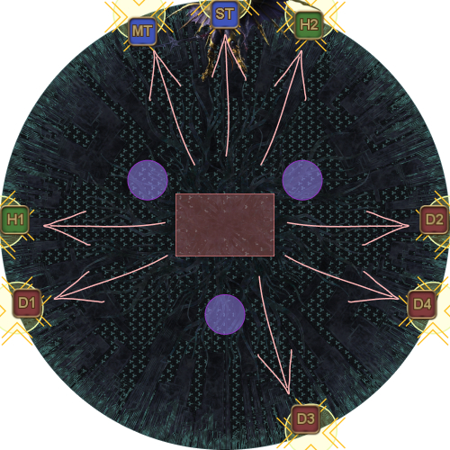
    </td>
  </tr>
  <tr>
    <td>
      
<b>6.</b> Heavensfall 塔的 AoE 出現。

      
和轉場至 Nael 時不同，這些 AoE 只會以順時針或逆時針方向繞行一整圈。

    </td>
    <td>
      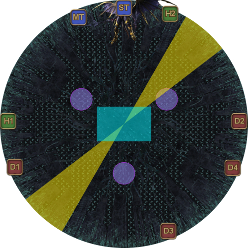
    </td>
  </tr>
  <tr>
    <td>
      
<b>7.</b> 第二組塔的 AoE 出現，藉此判斷 AoE 正在順時針還是逆時針移動。

      

        
<b>提示：</b> 第一和第二道扇形 AoE 之間的間隔明顯較長（後續扇形之間則沒有）。

        
若你就在附近，可利用這段時間移動到第一道扇形爆炸後的空位。

      

    </td>
    <td>
      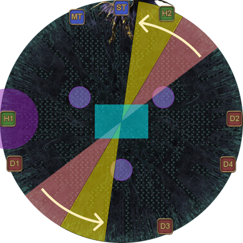
    </td>
  </tr>
  <tr>
    <td>
      
<b>8.</b> 向場地中央螺旋移動，同時 Nael 對隨機玩家施放四次 Hypernova。注意不要把 Hypernova 引導到場地中央。

    </td>
    <td>
      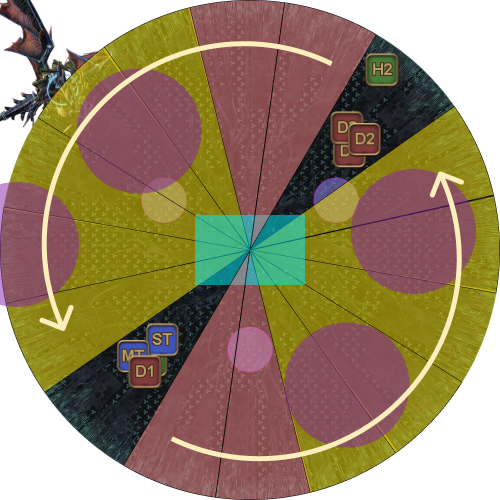
    </td>
  </tr>
  <tr>
    <td>
<b>9.</b> 一名隨機玩家會被標記為 Twintania 的 Fireball 目標。
</td>
    <td>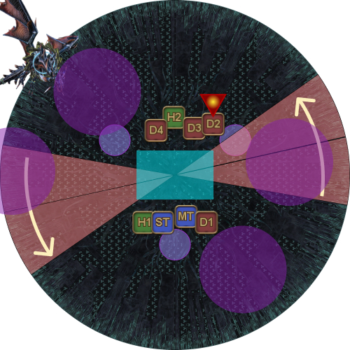</td>
  </tr>
  <tr>
    <td>
      
<b>10.</b> 在中央集合分攤 Twintania 的 Fireball 傷害。

      
Bahamut 現身並開始詠唱 Gigaflare。

      

        <b>提示：</b> 若發生意外導致有人死亡，可考慮犧牲 Fireball 目標，讓其遠離隊伍獨自承受 Fireball 分攤。
      

    </td>
    <td>
      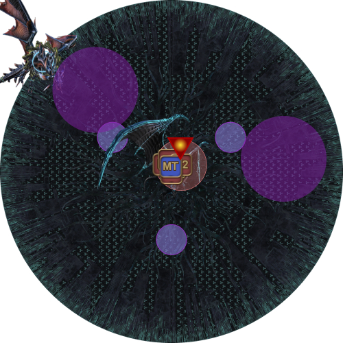
    </td>
  </tr>
</table>

---

## Tenstrike Trio

和 Blackfire Trio 之後一樣，巴哈姆特會對坦克施放三次 Flare Breath，然後開始 Tenstrike Trio。

<table>
  <tr>
    <td width="50%">
      
<b>1.</b> 由西向東排成一列。

    </td>
    <td>
      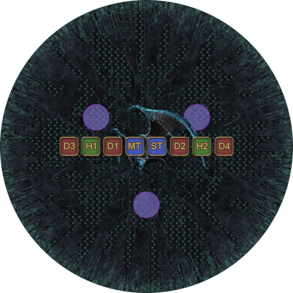
    </td>
  </tr>
  <tr>
    <td>
      
<b>2.</b> Twintania 在中央現身，三名隨機玩家（包括坦克和治療）會被 Hatch 鎖定。

    </td>
    <td>
      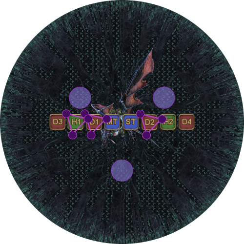
    </td>
  </tr>
  <tr>
    <td>
      
<b>3.</b> 由左至右，三名被鎖定的玩家分別進入西北、南、東北 Neurolink。

      
沒有被鎖定的玩家散開。

      <ul>
        <li><b>不要站在帶有 Hatch 的玩家身後</b>。</li>
      </ul>
      
沒有被第一輪鎖定的玩家中，有三人會接第二輪 Hatch。

      <ul>
        <li>玩家通常會跳一下，表示自己要負責附近的 Neurolink。</li>
        <li>接第二輪的玩家應站在 Neurolink 旁邊。</li>
      </ul>
    </td>
    <td>
      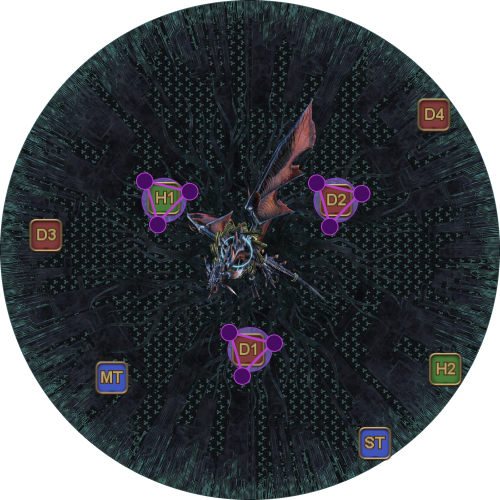
    </td>
  </tr>
  <tr>
    <td>
      
<b>4.</b> 第一輪 Hatches 抵達三名被鎖定玩家並結算。

      
此時 Meteor Streams 會一次命中一名玩家<em>（圖中只展示前四名玩家）</em>，順序從 DPS 開始，接著是治療，最後是坦克。

    </td>
    <td>
      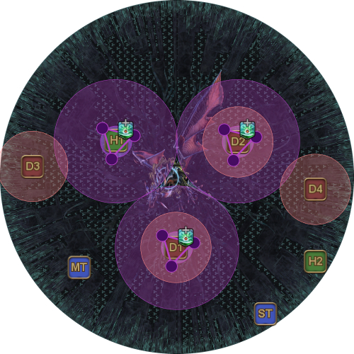
    </td>
  </tr>
  <tr>
    <td>
      
<b>5.</b> 第一輪 Hatches 結算後，被 Hatch 鎖定的玩家<b>沿直線移動至場地邊緣</b>。

      
接第二輪 Hatch 的三名玩家進入 Neurolink。

      
進入和離開的玩家路線<b>不可交叉</b>。

      

        
<b>注意：</b>不知為何，南側 Neurolink 有點難處理——Hatch 往往會<em>繞著</em> Neurolink 彎曲（稍微偏向東側），而不是走直線。

      

    </td>
    <td>
      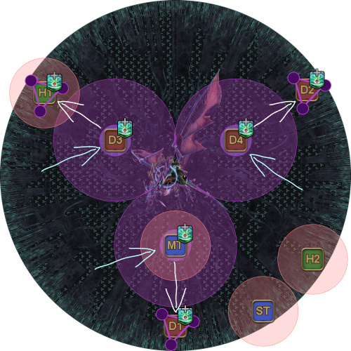
    </td>
  </tr>
  <tr>
    <td>
      
<b>6.</b> 第二輪 Hatch 結算後，Twintania 消失，四名隨機玩家會被標記為 Earthshaker 目標。

    </td>
    <td>
      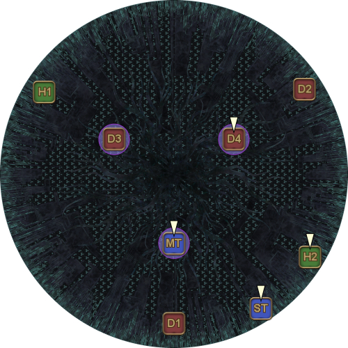
    </td>
  </tr>
  <tr>
    <td>
      
<b>7.</b> 四名被標記的玩家沿場地北側散開以引導 Earthshaker。

      
四名沒有標記的玩家在南側 Neurolink <b>站成正方形</b>。

      
正方形代表這四名玩家稍後要散開的方向。

      

        
<b>提示：</b> 如果你在南側 Neurolink 放置了方形標記，四名沒有標記的玩家可以站在方形的四個角上。

      

    </td>
    <td>
      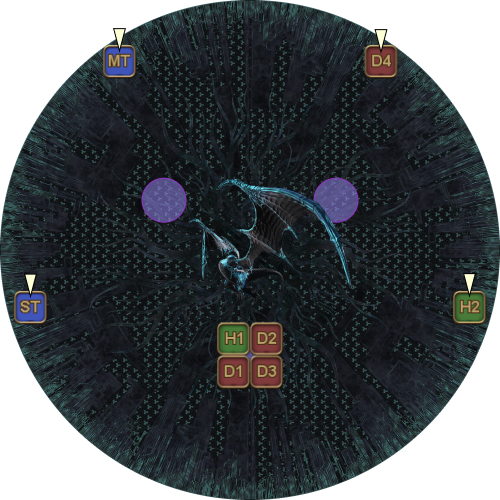
    </td>
  </tr>
  <tr>
    <td>
      
<b>8.</b> 第一輪 Earthshakers 結算。

      
先前沒有標記的四名玩家會被標記為 Earthshaker 目標。

    </td>
    <td>
      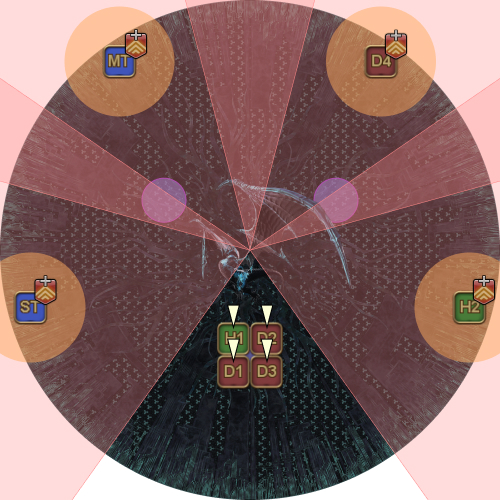
    </td>
  </tr>
  <tr>
    <td>
      
<b>9.</b> 兩組各四名玩家交換位置。

    </td>
    <td>
      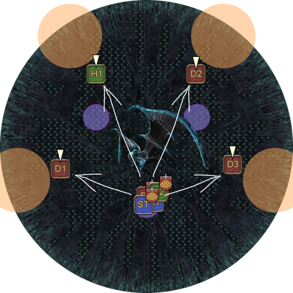
    </td>
  </tr>
  <tr>
    <td>
      
<b>10.</b> 第二輪 Earthshakers 結算。

      
Bahamut 開始詠唱 Gigaflare。

    </td>
    <td>
      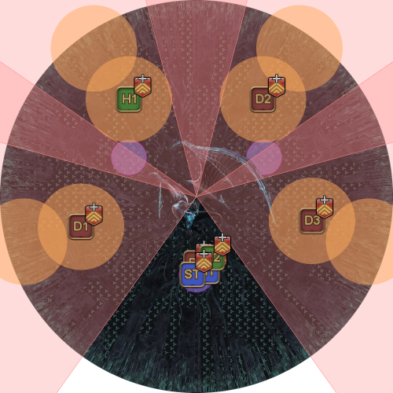
    </td>
  </tr>
</table>

---

## Grand Octet（使用坦克 LB）

Tenstrike 結束後，巴哈姆特會施放 Flatten 和 Flare Breath，然後開始 *Grand Octet*。

在 Bahamut 消失並進入 *Grand Octet* 前，其 HP 必須降至 **60% 以下**，否則黃金巴哈姆特會獲得增傷效果（傷害約為 5 倍），使標準隊伍無法通關（但仍可開荒至小怪階段）。

*（這如今*真的*不應該是問題。）*

<table>
  <tr>
    <td width="50%">
      
<b>1.</b> Bahamut 詠唱 Grand Octet 時，場地外圍會出現五隻龍。

轉動鏡頭查看空位，準備應對接下來的機制。

    </td>
    <td>
      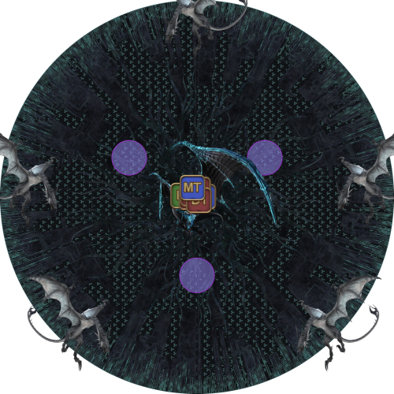
    </td>
  </tr>
  <tr>
    <td>
      
<b>2.</b> Twintania、Nael 和 Bahamut 會出現在剩下的三個空位。

      <ol>
        <li>找到 Bahamut。</li>
        <li>判斷 Bahamut 位於正方向還是斜角方向。
          <ul>
            <li><b>若 Bahamut 位於正方向：</b> 隊伍要<b>逆時針</b>移動。</li>
            <li><b>若 Bahamut 位於斜角方向：</b> 隊伍要<b>順時針</b>移動。</li>
          </ul>
        </li>
        <li>確認 Nael 是否正好在 Bahamut 對面。</li>
      </ol>
      

        
<b>提示：</b> 可以在中央放置方形標記輔助判斷。

        
若 Bahamut 與方形標記的邊對齊，則位於正方向；否則 Bahamut 會與標記的角對齊，位於斜角方向。

      

    </td>
    <td>
      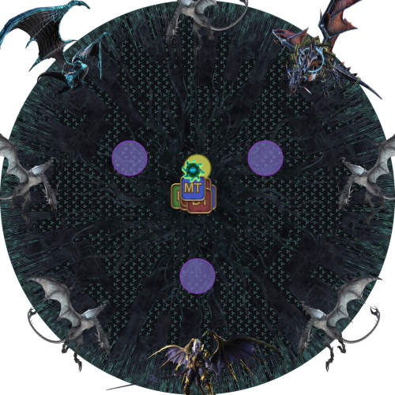
    </td>
  </tr>
  <tr>
    <td>
      
<b>3.</b> 兩名玩家會獲得俯衝標記——一名是 Nael（黃色標記），另一名是五隻龍中的其中一隻。

      
標記出現時，跑到 Bahamut 的<b>對面</b>。

      <ul>
        <li><b>若 Nael 位於 Bahamut 對面：</b> 跑到 Bahamut 對面後，再沿著隊伍將移動的方向多走一個位置。</li>
      </ul>
      
<em>（第二個例子中，Nael（東南）位於 Bahamut（西北）對面。由於 Bahamut 位於斜角方向，隊伍從 Nael 的位置順時針移動一個位置。）</em>

    </td>
    <td>
      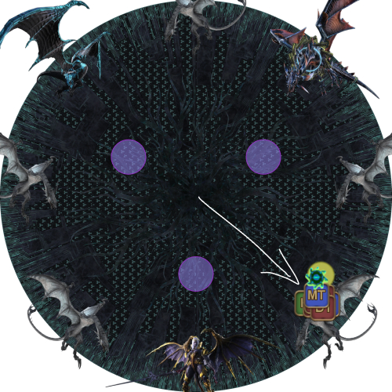
      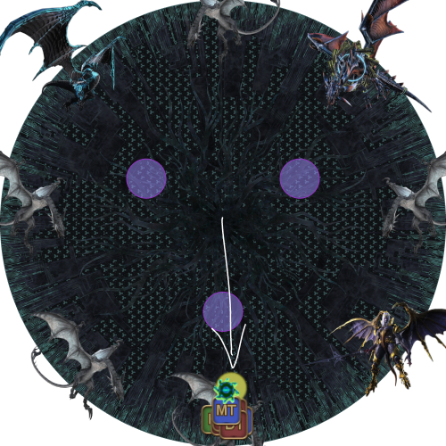
    </td>
  </tr>
  <tr>
    <td>
      
<b>4.</b> Nael 俯衝。

接著隊伍依 Bahamut 的位置順時針或逆時針移動。

      
其他四隻龍會依序鎖定玩家進行俯衝。

      
繞場移動時，<b>留意自己是否拿到俯衝標記</b>。

    </td>
    <td>
      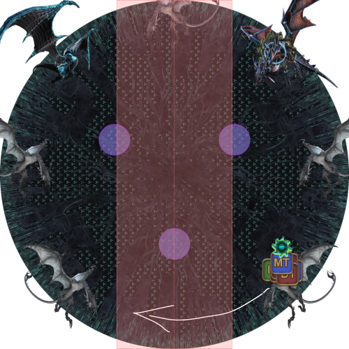
    </td>
  </tr>
  <tr>
    <td>
      
<b>5.</b> 隊伍接近 Bahamut 時，建議使用 Sprint，確保自己跑在俯衝前面。

    </td>
    <td>
      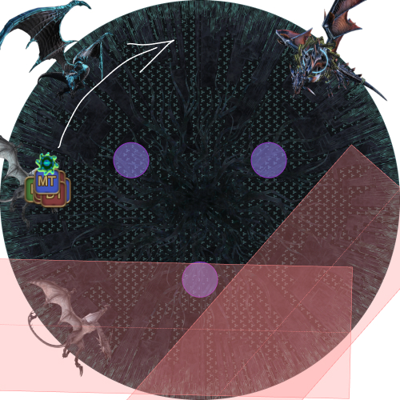
    </td>
  </tr>
  <tr>
    <td>
      
<b>6.</b> 五隻龍都鎖定玩家施放俯衝後，Bahamut 會從尚未被俯衝標記鎖定的兩名玩家中，再選一人作為目標。

      
<b>紅色俯衝標記出現時</b>，跑到場地中央。

      
此時只剩一名玩家尚未被俯衝鎖定。 
      該玩家準備引導 Twintania 的俯衝。

    </td>
    <td>
      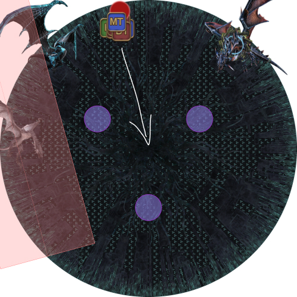
    </td>
  </tr>
  <tr>
    <td>
      
<b>7.</b> Bahamut 俯衝。<b>找到 Twintania</b>。

    </td>
    <td>
      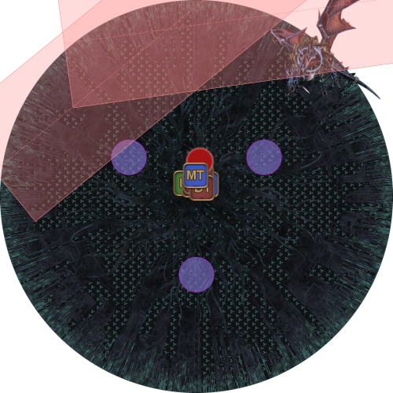
    </td>
  </tr>
  <tr>
    <td>
      
<b>8.</b> 四名隨機玩家會獲得 Megaflare 標記，並出現四座塔。

      <ul>
        <li><b>塔出現時</b>: 坦克 LB3</li>
        <li><b>尚未獲得俯衝標記的玩家：</b> 到 Twintania 左側（逆時針方向）。
        <ul>
          <li>如果這名玩家是坦克，則由<em>另一名</em>坦克改為使用 LB3。</li>
        </ul>
        </li>
      </ul>
      
隊伍散開，並由四名玩家各自踩一座塔。

      
<b>忽略 Megaflare 標記。</b>

    </td>
    <td>
      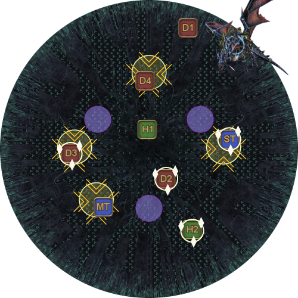
    </td>
  </tr>
  <tr>
    <td>
      
<b>9.</b> Twintania 的（綠色）俯衝標記出現時，該玩家要躲到 Twintania 的另一側。

    </td>
    <td>
      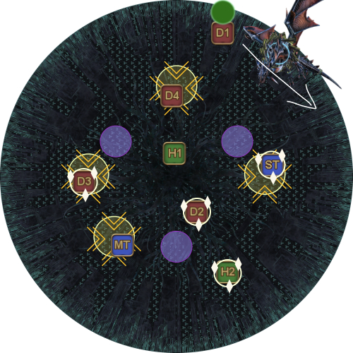
    </td>
  </tr>
  <tr>
    <td>
      
<b>10.</b> Twintania 俯衝，塔、Megaflare「分攤」和 Twisters 同時結算。

      
注意 Twisters，並集合準備進入小怪階段。

    </td>
    <td>
      
    </td>
  </tr>
</table>

### Grand Octet（不使用坦克 LB3）

若沒有坦克 LB3，Grand Octet 會變得難很多。

最後部分的流程都相同，但玩家分工固定如下。

- 負責 Twintania 的玩家仍然前往 Twintania 左側。
- **Megaflare 玩家在 Twintania 右側集合。**
- **沒有 Megaflare 的玩家踩塔。**

不過，負責 Twintania 的玩家可能屬於 Megaflare 組，也可能屬於踩塔（沒有 Megaflare）組。

<table>
  <tr>
    <td width="50%">
      
<b>若負責 Twintania 的玩家沒有 Megaflare</b>

      <ul>
        <li>其他三名沒有 Megaflare 標記的玩家踩其中三座塔，<b>離 Twintania 最近的塔留空</b>。</li>
        <li>四名有 Megaflare 的玩家在 Twintania 右側稍微分散地集合。</li>
      </ul>
      
Twintania 的俯衝標記出現時，負責 Twintania 的玩家前往空塔。

    </td>
    <td>
      
    </td>
  </tr>
  <tr>
    <td>
      
<b>若負責 Twintania 的玩家有 Megaflare</b>

      <ul>
        <li>四名沒有 Megaflare 的玩家分別踩四座塔。</li>
        <li>另外三名 Megaflare 玩家在 Twintania 右側稍微分散地集合，留出一個位置給負責 Twintania 的玩家。</li>
      </ul>
      
Twintania 的俯衝標記出現時，負責 Twintania 的玩家加入 Megaflare 分攤。

    </td>
    <td>
      
    </td>
  </tr>
</table>

---

## 常見問題

  <b>[Quickmarch Trio]</b> 為什麼要沿場地邊緣移動來躲避 Twisters？

<table>
  <tr>
    <td width="50%">
      
這樣躲避 Twisters 有兩個好處：

      <ul>
        <li>讓隊伍稍微散開，避免重疊（沒有預兆的）Megaflare AoE。</li>
        <li>讓場地中央周圍不會被大型（有預兆的）Megaflare AoE 佔據，治療便能有清楚路線移動至中央，以範圍治療 DPS 分攤組。</li>
      </ul>
    </td>
    <td>
      
    </td>
  </tr>
</table>

  <b>[Heavensfall Trio]</b> 俯衝 AoE 之間真的有很小的空隙嗎？

<table>
  <tr>
    <td width="50%">
      
有。

不要利用那些空隙。

    </td>
    <td>
      
    </td>
  </tr>
</table>

---

## 疑難排解

  <b>[Fellruin Trio]</b> 坦克來不及進入 Neurolink，無法在 Aetherial Profusion 中存活！

<table>
  <tr>
    <td>
      
若 Nael 說出 <em>Raven's Dive → Lunar Dynamo</em>，而她俯衝的目標站得太後面（靠近場地邊緣），就可能發生這種情況。

      
坦克可以把 Sprint 留到這裡使用。

    </td>
  </tr>
</table>

  <b>[Tenstrike Trio]</b> Hatch 球為什麼會繞著 Neurolink 彎曲？

<table>
  <tr>
    <td>
      
Hatch 會瞄準你角色的<em>背後</em>。

      
因此，Tenstrike Trio 期間移動時應盡可能走直線、<em>盡量少轉向</em>，因為轉動角色可能導致 Hatch 彎出 Neurolink。

      
治療特別容易遇到這種情況，因為他們會先直線跑出，然後轉身治療其他人。

    </td>
  </tr>
</table>

