# Twintania + Nael deus Darnus

此階段通常稱為「小怪階段」。一開始可能令人不知所措，但實際上與戰鬥前段的 Nael 階段相比，混亂程度**較低**。

此階段基本上是以下流程重複兩次：

1. Plummet/Bahamut's Claw
2. Liquid Hell
3. Hatches → Twisters
4. Nael 的台詞 → Twisters
5. Megaflare → Death Sentence/Ravensbeak *（第二輪會交換順序）*

Aethertrial Attunement 計量條會作為狂暴計時器出現，不過可以不用理會——第二輪結束後幾秒，計量條自然就會填滿。

---

## 台詞

Nael 在此階段可能說出四種台詞。請注意，第一個機制一定是 Lunar Dynamo 或 Iron Chariot。

這點很重要，因為第二輪開始時，Nael 一定會先使用與第一輪相反的機制。

<table>
  <tr>
    <td>From <b>hallowed moon</b> I <b>descend</b>, upon <b>burning</b> earth
    to tread!</td>
    <td>
      
Lunar Dynamo → Raven's Dive → Thermionic Beam

      
<em>靠近 → 分散 → 集合分攤</em>

    </td>
  </tr>
  <tr>
    <td>From <b>hallowed moon</b> I bare <b>iron</b>, in my <b>descent</b> to
    wield!</td>
    <td>
      
Lunar Dynamo → Iron Chariot → Raven's Dive

      
<em>靠近 → 遠離 → 分散</em>

    </td>
  </tr>
  <tr>
    <td>Unbending <b>iron</b>, take <b>fire</b> and <b>descend</b>!</td>
    <td>
      
Iron Chariot → Thermionic Beam → Raven's Dive

      
<em>遠離 → 集合分攤 → 分散</em>

    </td>
  </tr>
  <tr>
    <td>Unbending <b>iron</b>, <b>descend</b> with <b>fiery</b> edge!</td>
    <td>
      
Iron Chariot → Raven's Dive → Thermionic Beam

      
<em>遠離 → 分散 → 集合分攤</em>

    </td>
  </tr>
</table>

<table>
  <tr>
    <td width="50%">
      
<b>1.</b> 兩位首領會在北側出現。

      
將兩位首領拉到場地南側，讓 Twintania 靠近前方的兩個 Neurolinks。

      <ul>
        <li><b>MT:</b> 負責拉住 Twintania。</li>
        <li><b>ST:</b> 負責拉住 Nael。</li>
      </ul>
      
兩位首領會以各自的小型坦克死刑開場：<em>Plummet</em> 和 <em>Bahamut's Claw</em>。

      
務必讓 Twintania 的 <em>Plummet</em> 背對隊伍。

    </td>
    <td>
      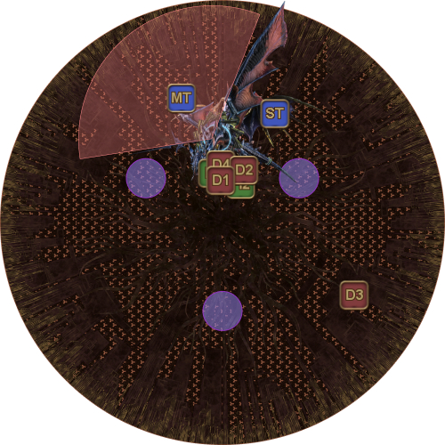
    </td>
  </tr>
  <tr>
    <td>
      
<b>2.</b> 接著 Twintania 會施放五輪 <em>Liquid Hell</em>，由距離超過一定範圍的隨機玩家引導。

      <ul>
        <li><b>D3:</b> 引導 <em>Liquid Hells</em>。</li>
        <li><b>其他所有玩家：</b>待在 Twintania 附近，以免意外成為 <em>Liquid Hell</em> 目標。</li>
      </ul>
    </td>
    <td>
      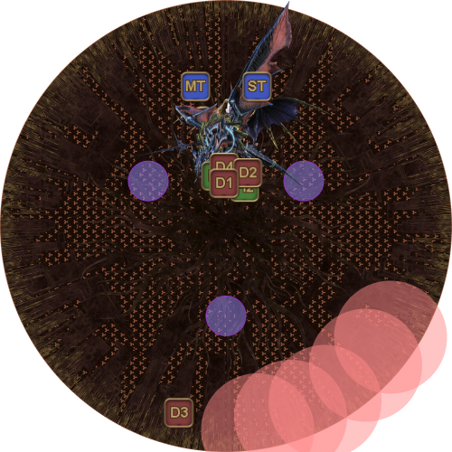
    </td>
  </tr>
  <tr>
    <td>
      
<b>3.</b> Twintania 會隨機以三名輸出職為 Hatches 目標。

      
基本站位如下：

      <ul>
        <li><b>D1:</b> 左上方 Neurolink。</li>
        <li><b>D2:</b> 右上方 Neurolink。</li>
        <li><b>D3:</b> 下方 Neurolink。</li>
        <li><b>D4:</b> 彈性調整玩家（起始時站中央）。</li>
      </ul>
      
由於會有一名隨機輸出職不會被 Hatch 點名，D4 需依該玩家的情況調整站位。

      <ul>
        <li><b>若 D4 沒有 Hatch：</b>D4 前往場地邊緣。</li>
        <li><b>若 D4 有 Hatch：</b>找出沒有被點名的玩家並接替其位置，該玩家則前往場地邊緣。</li>
      </ul>
      
<em>（此例中 D2 沒有被 Hatch 點名，因此 D4 前往右上方 Neurolink。）</em>

    </td>
    <td>
      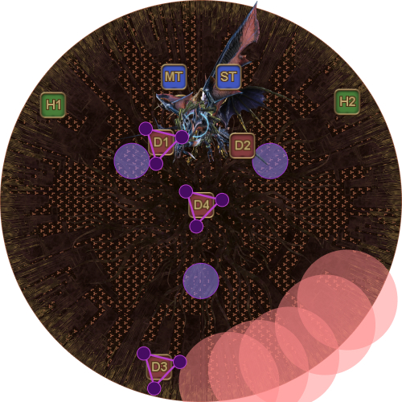
    </td>
  </tr>
  <tr>
    <td>
      
<b>4.</b> Hatches 朝玩家移動，Twintania 同時開始詠唱 <em>Twister</em>。

      <ul>
        <li><b>若你在前方其中一個 Neurolink：</b>先處理 Hatch，再移出躲避 <em>Twister</em>。</li>
        <li><b>若你在後方 Neurolink：</b>先在 Neurolink 外引導 <em>Twister</em>，再處理 Hatch。</li>
      </ul>
    </td>
    <td>
      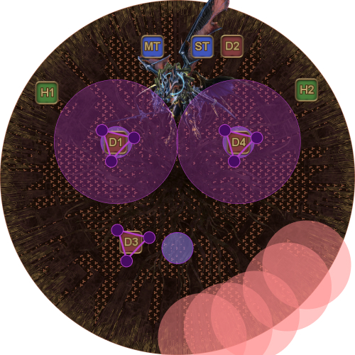
    </td>
  </tr>
  <tr>
    <td>
      
<b>5.</b> <em>Twisters</em> 判定。

      
後方的玩家接著進入 Neurolink 處理 Hatch。

    </td>
    <td>
      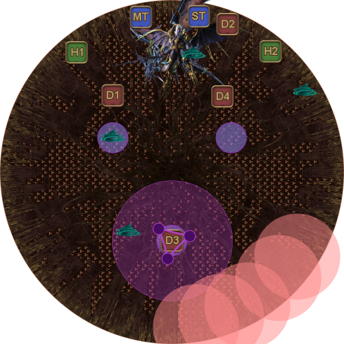
    </td>
  </tr>
  <tr>
    <td>
      
<b>6.</b> 接著 Nael 會說出隨機台詞。

      
第一個機制一定是 <em>Lunar Dynamo</em> 或 <em>Iron Chariot</em>。

    </td>
    <td>
      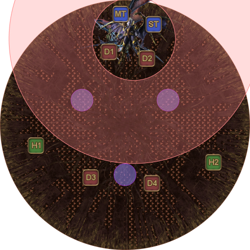
    </td>
  </tr>
</table>

Nael 的台詞會由 *Lunar Dynamo、Iron Chariot、Raven's Dive* 和 *Thermionic Beam* 組合而成。

請注意，由於 Nael 位於場地邊緣，遠距離職業可以站在 *Lunar Dynamo* 範圍之外。

<table>
  <tr>
    <td width="50%">
      
<em>Lunar Dynamo（靠近或站在範圍外）</em>

      
    </td>
    <td>
      
<em>Iron Chariot（遠離）</em>

      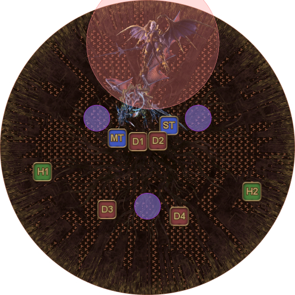
    </td>
  </tr>
  <tr>
    <td>
      
<em>Raven's Dive（分散）</em>

      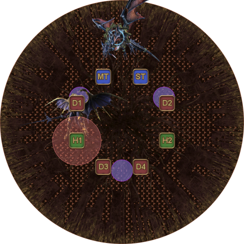
    </td>
    <td>
      
<em>Thermionic Beam（集合分攤）</em>

      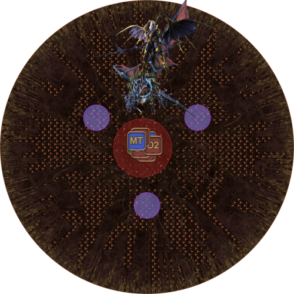
    </td>
  </tr>
</table>

<b>注意：</b>請特別留意先施放 <em>Raven's Dive</em>、再接 <em>Thermionic Beam</em> 的台詞。此處最<em>常見</em>的團滅原因之一，就是全員沒有及時集合。

<table>
  <tr>
    <td width="50%">
      
<b>7.</b> 最後，Nael 的台詞結束後，Twintania 會施放 <em>Twister</em>。

      
依照 Raven's Dive 分散的相同方向散開。

    </td>
    <td>
      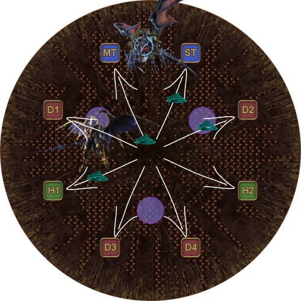
    </td>
  </tr>
  <tr>
    <td>
      
<b>8.</b> 小心地重新集合至場地中央，並注意 <em>Twisters</em>（尤其是 Neurolinks 上的！）。

      
Nael 會施放 <em>Megaflare</em>，接著兩位首領施放主要坦克死刑 <em>(Death Sentence</em> 與 <em>Ravensclaw)</em>。

      
這些坦克死刑附加的易傷效果要求換坦；使用 Provoke，<em>但不要使用 Shirk</em>。

      
從這裡開始由坦克交換位置，而不是交換首領（也就是 Twintania 留在「西側」，Nael 留在「東側」）。

    </td>
    <td>
      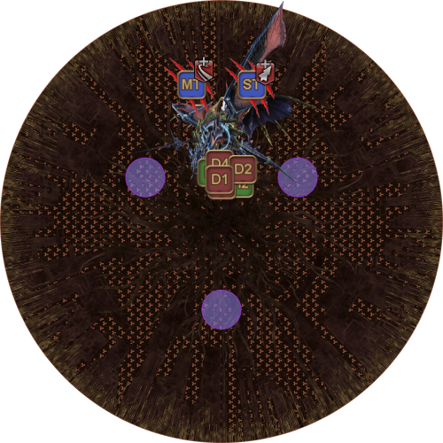
    </td>
  </tr>
</table>

接著從 *Plummet/Bahamut's Claw* 開始重複循環。

第二輪與第一輪有以下差異：

- 如果 Nael 第一輪以 *Lunar Dynamo* 開始，第二輪便會以 *Iron Chariot* 開始，反之亦然。
- 第一輪中，*Megaflare* 會在換坦前出現；第二輪則先換坦。

Twintania 和 Nael 必須同時擊殺。若其中一位先倒下，另一位會立即開始詠唱 *Twin Fury/White Fury*；這是 3 秒的狂暴詠唱，會使其 HP 完全恢復。

為了同時擊殺兩位首領，當兩者 HP 都降至 1% 時，使用法系 LB 或遠程 LB。

成功的話，Bahamut 的 *Teraflare* 仍會擊倒全隊，但 Phoenix 會讓全隊以滿 HP/MP 復活（就像治療職 LB3），並將極限技量表補滿至 LB3。

<b>注意：</b>和治療職 LB3 一樣，Phoenix 的復活會重置玩家身上的衰弱狀態；若有人在階段結束前剛好死亡，可以考慮不要拉起他，讓 Phoenix 復活時不帶衰弱。

## 常見問題

  <b>[Twintania + Nael]</b> 兩位首領的初始 HP 百分比不同——應該優先攻擊其中一位嗎？

<table>
  <tr>
    <td>
      
其實不需要。Twintania 的最大 HP 高於 Nael，但兩位首領在階段開始時的 HP 大致相同（Nael 只比 Twintania 多一點點），因此 Nael 的初始 HP 百分比才會比較高。

    </td>
  </tr>
</table>

