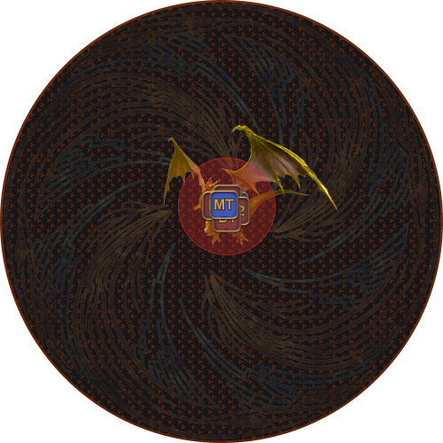
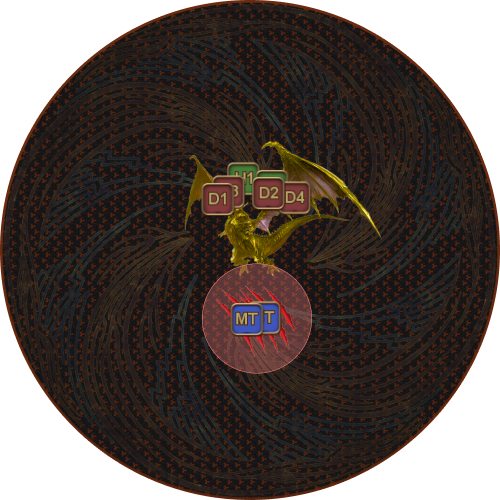
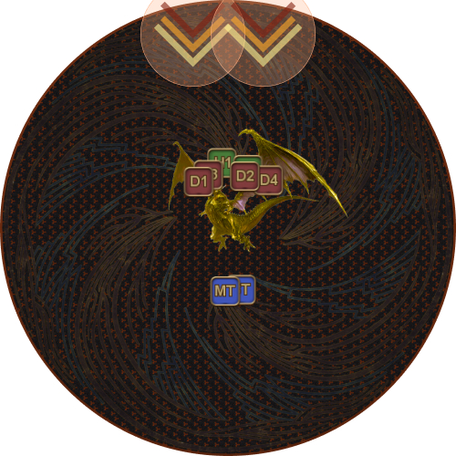
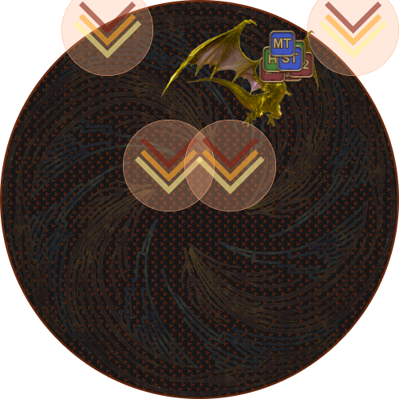
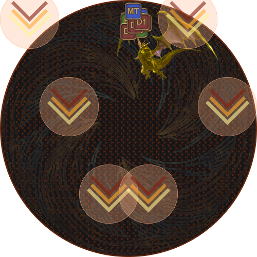
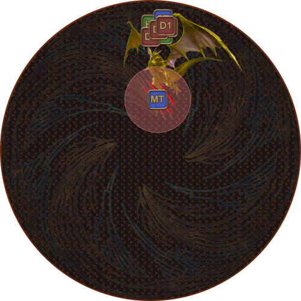
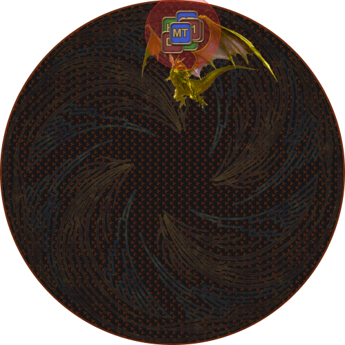

# 黃金巴哈姆特

本階段常被暱稱為「勝利巡禮」，因為它遠比整場戰鬥中的其他階段
都要簡單得多。

鳳凰會使全隊復活，讓所有隊員恢復完整 HP/MP、獲得 LB3，並取得
*Phoenix's Blessing* 強化效果。

<table>
  <tr>
    <td style="text-align:center">
      
    </td>
    <td>
      
<b>Phoenix's Blessing</b>

      
<em>造成的傷害提高。</em>

      <ul>
        <li>使玩家造成的傷害加倍。</li>
      </ul>
    </td>
  </tr>
</table>

玩家死亡時會*失去*此強化效果，因此本階段死亡的代價更高（尤其是 DPS 在階段初期陣亡時）。

巴哈姆特再次現身，並變身為黃金巴哈姆特。

若先前未將巴哈姆特的 HP 降至 60% 以下，黃金巴哈姆特在階段開始時會帶有 5 倍增傷效果 *("Bahamut grows mightier still!")*
這會使標準隊伍配置無法通關本階段。

最終階段由以下三種機制循環組成：

1. Morn Afah （全隊分攤）
2. Akh Morn （坦克分攤死刑）
3. Exaflares

此循環總共重複五次，但只有第二輪的 *Morn Afah* 與 *Akh Morn* 順序會互換。

---

## 減傷安排

本階段需要事先規劃並協調減傷。建議的基本減傷安排如下：

<table>
  <tr>
    <td><b>Morn Afah #1</b> (0:06)</td>
    <td>
MT 90 秒、ST Reprisal、H2 護盾、H2 30 秒、D1、D4
</td>
  </tr>
  <tr>
    <td><b>Morn Afah #2</b> (1:01)</td>
    <td>ST 90 秒、MT Reprisal、H2 護盾、H2 30 秒、D3</td>
  </tr>
  <tr>
    <td><b>Morn Afah #3</b> (1:34)</td>
    <td>MT 90 秒、ST Reprisal、H2 護盾、H2 30 秒、D1、D4</td>
  </tr>
  <tr>
    <td><b>Morn Afah #4</b> (2:25)</td>
    <td>MT Reprisal、ST 90 秒、H2 護盾、H2 30 秒、D2</td>
  </tr>
  <tr>
    <td><b>Morn Afah #5</b> (3:11)</td>
    <td>MT 90 秒、ST Reprisal、H2 護盾、H2 30 秒、D3、D4</td>
  </tr>
</table>

現在黃金巴哈姆特的 DPS 檢定（非常）寬鬆。若發生意外，可考慮使用坦克 LB 協助
減輕 Morn Afah 的傷害。

坦克也需要規劃好應對 Akh Morn 的減傷技能。

<table>
  <tr>
    <td><b>Akh Morn #1</b></td>
    <td>
MT + ST 分攤，Rampart + 30% 減傷 + 短 CD 減傷
</td>
  </tr>
  <tr>
    <td><b>Akh Morn #2</b></td>
    <td>MT 無敵</td>
  </tr>
  <tr>
    <td><b>Akh Morn #3</b></td>
    <td>ST 無敵</td>
  </tr>
  <tr>
    <td><b>Akh Morn #4</b></td>
    <td>MT + ST 分攤，Rampart + 30% 減傷 + 短 CD 減傷</td>
  </tr>
</table>

<table>
  <tr>
    <td width="50%">
      
<b>1.</b> 黃金巴哈姆特首先會鎖定一名隨機隊員 
      施放 Morn Afah。

      
這是需要全 8 人分攤、傷害極高的攻擊。

    </td>
    <td>
      
    </td>
  </tr>
  <tr>
    <td>
      
<b>2.</b> 接著黃金巴哈姆特會鎖定坦克施放 Akh Morn。

      
兩名坦克應一起分攤此攻擊。

      
第一次 Akh Morn 時，<b>坦克要在南側 Neurolink 的位置集合</b>。

    </td>
    <td>
      
    </td>
  </tr>
  <tr>
    <td>
      
<b>3.</b> 黃金巴哈姆特施放 Exaflare。

      
第一組 Exaflare 出現。

    </td>
    <td>
      
    </td>
  </tr>
  <tr>
    <td>
      
<b>4.</b> 第二組 Exaflare 出現。

      
如果情況允許，盡量採用 3 比 1 的躲法 <em>（不一定總能使用 3 比 1 躲法）</em>。

    </td>
    <td>
      
    </td>
  </tr>
  <tr>
    <td>
      
<b>5.</b> 第三組 Exaflare 出現。

    </td>
    <td>
      
    </td>
  </tr>
  <tr>
    <td>
      
<b>6.</b> 黃金巴哈姆特對 MT 施放 Akh Morn。

      
注意，全隊待在<b>場地邊緣</b>，而坦克則<b>靠近中央</b>。

      
<em>之後每一輪此處都會改為 Morn Afah。</em>

    </td>
    <td>
      
    </td>
  </tr>
  <tr>
    <td>
      
<b>7.</b> 接著黃金巴哈姆特會以 Morn Afah 攻擊一名隨機（非坦克）玩家。

      
<em>之後每一輪此處都會改為 Akh Morn。</em>

    </td>
    <td>
      
    </td>
  </tr>
</table>

上述循環再重複四次後，黃金巴哈姆特會施放最後一次 
*Morn Afah*，依仇恨由高至低逐一鎖定玩家，作為硬狂暴。

---

## 常見問題

  <b>[一般]</b> 帶有增傷效果時能通關黃金巴哈姆特嗎？

<table>
  <tr>
    <td>
      
可以，因為確實有人做到過。

      
      
一支隊伍需要五名坦克輪流承受黃金巴哈姆特的攻擊，才能撐過自動攻擊；每一下都能秒殺坦克（傷害約為坦克最大 HP 的 150%！）。黃金巴哈姆特的自動攻擊也可能暴擊，即使有完整減傷與護盾，也幾乎足以秒殺坦克。

      
四名坦克會用無敵技能承受四次 <em>Akh Morn</em>，搭配大量護盾（SCH + SGE）與坦克 LB3，讓隊伍撐過其他每一次 <em>Morn Afah</em>，並犧牲中間攻擊的分攤目標。

      
能否成功極度仰賴 RNG。若坦克死於
      <em>Morn Afah</em> 且尚未輪替上場減輕黃金巴哈姆特
      自動攻擊的傷害，某些情況下要挽回局勢會極為困難，甚至不可能。

    </td>
  </tr>
</table>

