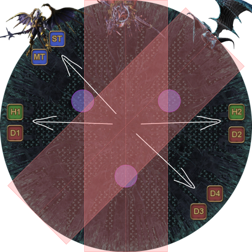
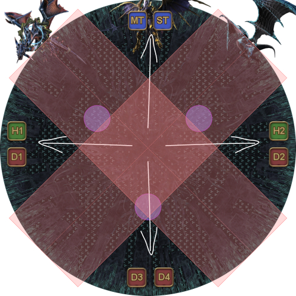
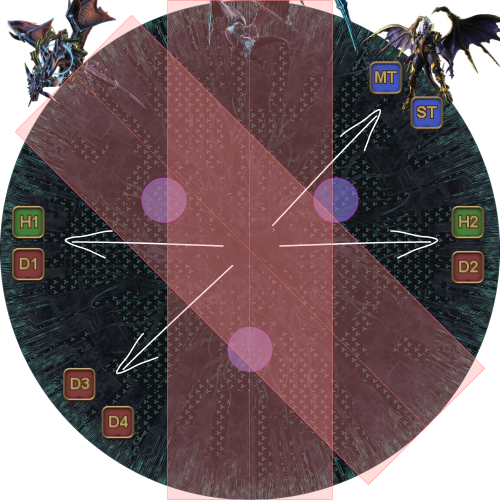
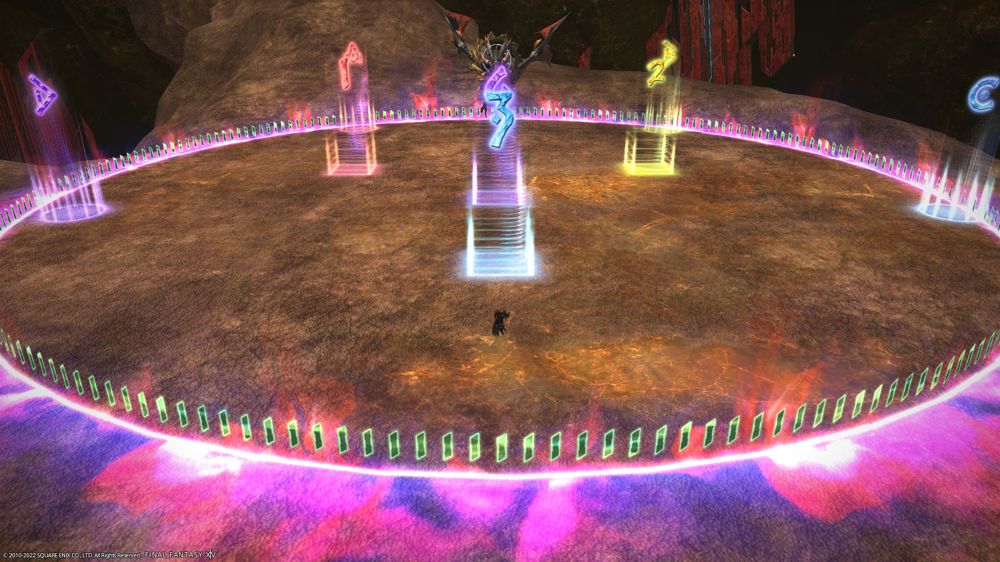

# 巴哈姆特絕境戰（絕）

野團打法大致遵循 [Clees 的 UCoB 攻略](https://clees.me/guides/ucob/)，但有幾處不同：

- Neurolinks 以倒三角形擺放。
- *Blackfire Trio* 的塔由坦克與治療職互換（治療職踩靠近 Megaflare 集合點的塔）。
- *Heavensfall Trio* 的散開位置不同（兩名坦克一律前往 Nael 方向，兩名遠程一律前往 Nael 的對側）。
<table>
  <tr>
    <td>
      
    </td>
    <td>
      
    </td>
    <td>
      
    </td>
  </tr>
</table>

- *Tenstrike Trio* 只使用一個安全點（南方標記），而非兩個。

### BiS 裝備備註

- 裝備品級達 **i470** 以上時，副屬性即可達上限。
- 魂武的副屬性上限為 **127**。
- 能獲得最大收益的最低級藥水為 **HQ Grade 3 Tinctures**。

---

## 繁體中文



<details markdown=block>
<summary>精簡版配置（備用）</summary>



</details>

---

## 標記

**Twintania:**
- `123`：Neurolink 位置。
- `3`：轉場至 Nael 時的集合位置。

**Nael:**
- `3`：轉場至 Bahamut 時的集合位置。
- `4`：處理 *Thermionic Beam*、Fire 連線時的集合位置。

**Bahamut Prime:**
- `ABCD` 標記用於 *Tenstrike Trio* 的 Earthshakers。
- `123`：*Fellruin Trio* 中首領的出現位置；也是 *Heavensfall Trio* 的擊退判斷邊界。
- `3`：*Tenstrike Trio* 的安全點。建議使用方形標記，方便玩家溝通第二次 *Earthshaker* 的站位。
- `4`：*Blackfire Trio* 開始時及 *Heavensfall Trio* 結束時的集合點。在 *Grand Octet* 中也用來判斷 Bahamut 位於正點（標記邊）或斜點（標記角）。

**Golden Bahamut:**
- `3`：Golden Bahamut 第一次 *Akh Morn* 時坦克集合的位置。


<details markdown=block>
<summary>XIVLauncher WaymarkPresetPlugin 座標</summary>

```json
{
  "Name":"UCoB",
  "MapID":280,
  "A":{"X":-11.472,"Y":0.0,"Z":-16.383,"ID":0,"Active":true},
  "B":{"X":11.47153,"Y":0.0,"Z":-16.383,"ID":1,"Active":true},
  "C":{"X":19.31852,"Y":0.0,"Z":5.176381,"ID":2,"Active":true},
  "D":{"X":-19.319,"Y":0.0,"Z":5.176,"ID":3,"Active":true},
  "One":{"X":-7.57,"Y":0.0,"Z":-4.38,"ID":4,"Active":true},
  "Two":{"X":7.57,"Y":0.0,"Z":-4.38,"ID":5,"Active":true},
  "Three":{"X":0.0,"Y":0.0,"Z":8.75,"ID":6,"Active":true},
  "Four":{"X":0.0,"Y":0.0,"Z":0.0,"ID":7,"Active":true}
}
```

</details>

---

## 常見問題

<details markdown=block>
<summary><b>[Damage Down]</b> 這場戰鬥中的傷害降低效果有多強？</summary>
<table>
  <tr>
    <td>
      <p>本戰鬥中因機制失誤而附加 Damage Down 的情況不多；但一旦受到效果，玩家造成的傷害會降低 <b>50%</b>。</p>
    </td>
  </tr>
</table>
</details>

<script data-goatcounter="https://tuufless.goatcounter.com/count"
        async src="//gc.zgo.at/count.js"></script>
